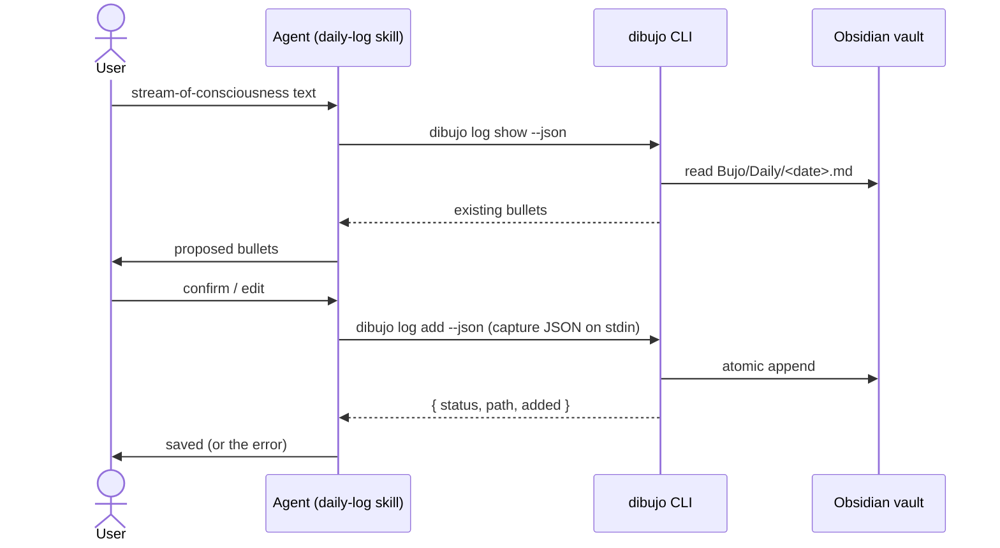

# Design: core daily log

## Overview

This design covers the `digi-bujo` package (executable `dibujo`), the vault note format, and the first workflow: the user talks to an agent, the agent loads the `daily-log` skill, turns the user's text into bullets, and saves them through the CLI.

The agent does the interpretation and the CLI does the bookkeeping. The CLI never calls an LLM, and the skill never touches vault files directly.



## Vault format (v1)

The full format is written up in `docs/vault-format.md`. That document is the user-facing source of truth, and this section is the design behind it.

### Location

`<vaultPath>/<folder>/Daily/YYYY-MM-DD.md`. `folder` defaults to `Bujo`. The date is the journal date (see [Journal date](#journal-date)).

### Example note

```markdown
---
dibujo: 1
type: daily
date: 2026-11-09
---

## Log

- [ ] call the bank about the card #priority
- [x] send invoice to Ana
* dentist at 3pm
- sleep was bad, too much screen time before bed
- idea: weekly review on sunday evenings #inspiration
    - [ ] block 30 min in calendar

## Captures

> [!capture]- 08:42 · 3f9a1b2c
> ok so today I need to call the bank about the card, that's the
> big one. sent the invoice to Ana already. dentist at 3. slept
> badly again, too much phone before bed.

> [!capture]- 21:10 · 9c04e7d1
> thinking I should do a weekly review on sunday evenings, need
> to block time for it
```

### Bullet syntax

| Bullet | Markdown | Bullet Journal symbol |
| --- | --- | --- |
| Task, open | `- [ ] text` | • |
| Task, completed | `- [x] text` | × |
| Task, migrated | `- [>] text` | > |
| Task, scheduled | `- [<] text` | < |
| Task, cancelled | `- [-] text` | ~~•~~ (struck) |
| Event | `* text` | ○ |
| Note | `- text` | – |

Signifiers are Obsidian tags at the end of the line:

| Signifier | Tag | Bullet Journal symbol |
| --- | --- | --- |
| Priority | `#priority` | * |
| Inspiration | `#inspiration` | ! |

Nesting: a bullet indented by 4 spaces or 1 tab per level is a child of the bullet above it. The parser reports the level as `depth`.

#### Why these choices

- **`*` for events, `-` for notes.** This follows your decision to use two list markers, and `-` matches the Bullet Journal dash for notes. The risk is that Obsidian displays both as the same dot, and Markdown formatters (Prettier, or the Obsidian Linter plugin with "list marker style" turned on) rewrite every `*` to `-`, which would turn all events into notes. Obsidian itself never rewrites markers, so this only matters if you add one of those tools. `docs/vault-format.md` will include a warning about it. If it becomes a problem, format v2 could switch to a prefix such as `- ○ dentist at 3pm`, which survives formatters. The version number in the frontmatter makes that change detectable.
- **Tags for signifiers, not leading `*` / `!`.** In Markdown, `- * text` starts a nested list and `![` starts an image, so the literal Bullet Journal symbols would break rendering. Tags display in Obsidian, are searchable, and work with Dataview.
- **Checkbox characters.** `x` and space work everywhere. `>`, `<` and `-` are the conventional "alternative checkbox" characters used by popular themes (Minimal, Things) and the Tasks plugin. Without a theme they still display as checkboxes and stay readable as text.

### Sections

- `## Log` holds the bullets. The parser reads from this heading up to the next `## ` heading.
- `## Captures` holds one collapsed callout per capture, in the order they were added. The callout title is `<HH:mm> · <capture id>`, and the body is the raw text with each line prefixed by `> `. Callouts are a core Obsidian feature, so no plugin is needed. Because every raw line is prefixed with `> `, raw text can never create a `## ` heading that would confuse the parser.
- Headings are matched case-insensitively. Any other sections the user adds are left untouched.

### Frontmatter

| Field | Meaning |
| --- | --- |
| `dibujo` | Format version. `1` for this spec. |
| `type` | `daily` |
| `date` | Journal date, `YYYY-MM-DD` |

Rules:
- The CLI writes frontmatter only when it creates a note.
- If a note already exists without frontmatter, or with frontmatter that has no `dibujo` field (for example, a note made by Obsidian's Daily Notes plugin), the CLI reads it as v1 and does not edit the frontmatter. Rewriting YAML could reformat the user's content, which Requirement 5.5 forbids.
- If `dibujo` is greater than the highest version the CLI supports, the CLI refuses to write and reports `NOTE_VERSION_UNSUPPORTED`.

### Parsing rules

- A line in `## Log` matching `^(\s*)[-*+] \[(.)\] (.*)$` is a task. The checkbox character sets the state: space → open, `x`/`X` → completed, `>` → migrated, `<` → scheduled, `-` → cancelled. Any other character is unrecognized. Any list marker is accepted when reading, because people type `* [ ]` by hand. The CLI always writes `-`.
- `^(\s*)\* (.*)$` is an event. `^(\s*)[-+] (.*)$` is a note.
- Signifier tags at the end of the text are removed from `text` and put in `signifiers`. Tags in the middle of the text stay in the text.
- Blank lines are ignored. Any other line (paragraphs, sub-headings, unknown checkbox characters) is returned in `unrecognized` with its line number and left unchanged in the file (Requirements 1.11 and 1.12).

### Capture identity

`captureId = first 8 hex chars of sha256(canonicalJson({ raw, bullets }))`. Before hashing, `raw` has its line endings normalized to `\n` and its trailing whitespace trimmed. `bullets` is the validated input in canonical key order. Submitting the same capture twice gives the same id. If a callout with that id is already in `## Captures`, the add returns `unchanged` (Requirement 5.6). Eight hex characters make a collision within one day's note negligible.

### Journal date

`journalDate(now, dayStartHour) = localDate(now − dayStartHour hours)`. With `dayStartHour: 4`, an entry at 01:30 on the 10th belongs to the 9th. `--date YYYY-MM-DD` overrides it and must be a real calendar date.

## CLI

### Commands

| Command | Purpose | Requirement |
| --- | --- | --- |
| `dibujo init [--vault <path>] [--folder <name>] [--day-start <hour>] [--force] [--json]` | Create or replace the config | 3 |
| `dibujo config [--json]` | Show the active config and where each value came from | 3.10 |
| `dibujo skills install [--harness <name> \| --target <dir>] [--force] [--dry-run] [--json]` | Install the skills | 4 |
| `dibujo log show [--date <YYYY-MM-DD>] [--json]` | Read a daily note | 6 |
| `dibujo log add [--date <YYYY-MM-DD>] [--dry-run] [--json]` | Add a capture read from stdin | 5 |

There are also the global options `--help` and `--version`.

### Capture input (`log add` stdin)

Validated with zod:

```ts
const BulletInput = z.object({
  type: z.enum(["task", "event", "note"]),
  text: z.string().trim().min(1)
    .refine((t) => !t.includes("\n"), "must be a single line")
    .refine((t) => !/^\[.\]\s/.test(t), "must not start with a checkbox")
    .refine((t) => !/#(priority|inspiration)\b/.test(t), "use `signifiers`, not tags in text"),
  state: z.enum(["open", "completed", "migrated", "scheduled", "cancelled"]).optional(), // tasks only, default "open"
  signifiers: z.array(z.enum(["priority", "inspiration"])).default([]),
  depth: z.number().int().min(0).max(3).default(0),
});

const CaptureInput = z.object({
  raw: z.string().trim().min(1),
  bullets: z.array(BulletInput).min(1),
});
```

A `state` on an event or note is rejected. A `depth` greater than the previous bullet's depth + 1 is rejected, so nesting is always valid. Every valid bullet must round-trip: `parseBulletLine(formatBullet(b))` equals `b`. This is what the refinements above guarantee.

If stdin is a TTY, `log add` exits with `USAGE` and a hint to pipe the JSON in, instead of waiting for input.

### Output contract

- Human mode prints short lines to stdout and errors to stderr.
- With `--json`, stdout contains exactly one JSON document, for both success and failure:

```jsonc
// success
{ "ok": true, "data": { /* command-specific */ } }
// failure
{ "ok": false, "error": { "code": "NOTE_CHANGED", "message": "…", "hint": "…" } }
```

`data` by command:

- `log add`: `{ "status": "created" | "updated" | "unchanged", "path", "date", "captureId", "added" }`. With `--dry-run` it also returns `"content"` (the full resulting note) and `"dryRun": true`.
- `log show`: `{ "exists", "path", "date", "bullets": Bullet[], "unrecognized": [{ "line", "text" }] }`
- `skills install`: `{ "target", "harness" | null, "results": [{ "skill", "status": "installed" | "updated" | "unchanged" | "skipped", "reason"? }] }`
- `config`: `{ "configPath", "values": { "vaultPath": { "value", "source": "default" | "file" | "env" }, … } }`
- `init`: `{ "configPath", "config" }`

### Errors and exit codes

All expected failures throw `DibujoError(code, message, hint?)`. The CLI entry point catches them, prints them in the current output mode, and exits.

| Code | Exit | When |
| --- | --- | --- |
| `USAGE` | 2 | Bad flags, conflicting flags (`--harness` with `--target`), a required input missing without a TTY, stdin is a TTY |
| `INVALID_INPUT` | 2 | Capture JSON fails to parse or validate. The message lists the zod issue paths. |
| `INVALID_DATE` | 2 | `--date` is not a real `YYYY-MM-DD` date |
| `UNKNOWN_HARNESS` | 2 | `--harness` is not in the table. The message lists the supported names. |
| `CONFIG_MISSING` | 1 | No config and no `DIBUJO_VAULT_PATH`. Hint: run `dibujo init`. |
| `CONFIG_INVALID` | 1 | The config file doesn't parse or validate |
| `CONFIG_EXISTS` | 1 | `init` without `--force` when a config exists and there is no TTY |
| `VAULT_NOT_FOUND` | 1 | The vault path is missing or not a directory |
| `NOTE_CHANGED` | 1 | The note changed on disk between read and write. Hint: retry. |
| `NOTE_VERSION_UNSUPPORTED` | 1 | The note's `dibujo` version is newer than this CLI supports |
| `INTERNAL` | 1 | Unexpected exception. The message is generic. The stack trace is printed only with `DIBUJO_DEBUG=1`. |

Commander's own parse errors are routed through `exitOverride()` and become `USAGE` (exit 2). Error messages contain paths and codes, never note text or raw capture text.

### Testability

Each command is a function `run(ctx, options)`, where `ctx` holds `{ env, now, stdin, stdout, stderr, isTTY, homedir }`. `src/cli/index.ts` builds the real `ctx` from `process`. Tests build a fake one with temp directories and a fixed clock, so no test touches the real home folder, config, or clock.

## Configuration

File: `$XDG_CONFIG_HOME/dibujo/config.json`, or `~/.config/dibujo/config.json` when `XDG_CONFIG_HOME` is not set.

```json
{ "version": 1, "vaultPath": "/Users/me/Vault", "folder": "Bujo", "dayStartHour": 0 }
```

| Key | Validation | Default | Env override |
| --- | --- | --- | --- |
| `vaultPath` | Absolute path to an existing directory. `~` is expanded in `init` input. | none (required) | `DIBUJO_VAULT_PATH` |
| `folder` | Relative path, no `..` segments, not absolute | `Bujo` | none |
| `dayStartHour` | Integer from 0 to 23 | `0` | none |

- **Loading:** defaults, then the file, then the environment. Each value records its source for `dibujo config`. Commands that need the vault call `requireVault(config)`, which throws `CONFIG_MISSING` or `VAULT_NOT_FOUND`.
- **Saving:** create the config directory with mode `0700`, write a temp file with mode `0600`, and rename it into place. A newly created `config.json` is therefore never readable by others, even briefly.
- **`init` flow:** values come from flags first. Missing values are asked for when there is a TTY, using `node:readline/promises` (no extra dependency), and each prompt shows its default. Without a TTY, a missing `--vault` is a `USAGE` error. If the vault has no `.obsidian/` folder, `init` prints a warning but continues, since the user may not have opened it in Obsidian yet.
- **Path safety:** every vault path is built through `resolveInVault(config, ...segments)`. It resolves the path and checks that it stays inside `<vaultPath>/<folder>`, which enforces "never write outside the vault folder".

## Writing a capture

`addCapture(config, date, capture, { dryRun, now })`:

1. Validate `capture`, compute `captureId`, and build `path`.
2. Read the file. If it doesn't exist, start from the new-note template.
3. If the note's `dibujo` version is unsupported, throw `NOTE_VERSION_UNSUPPORTED`.
4. Parse the sections. If a callout with `captureId` exists, return `unchanged`.
5. Build the new content with the pure function `appendCapture(original, bullets, callout)`:
   - Insert the formatted bullets after the last non-blank line of `## Log`. If `## Log` is missing, add it before `## Captures`, or at the end of the file if that is missing too.
   - Append the callout at the end of `## Captures`, separated by a blank line. Add the section at the end of the file if it is missing.
   - Assert that every line of `original` still appears, in order, in the result. This is an internal check: if it fails, the write is aborted with `INTERNAL`, so a bug can never destroy content (Requirement 5.5).
6. With `dryRun`, return the content without writing.
7. Write it atomically:
   - Write to `.<name>.<pid>.tmp` in the same directory and `fsync` it. The leading dot keeps Obsidian from indexing the temp file.
   - **New note:** `link(temp, path)`, which fails with `EEXIST` if the note appeared in the meantime. Map that to `NOTE_CHANGED`. Then `unlink(temp)`.
   - **Existing note:** read `path` again and compare it to the original content. If it differs, delete the temp file and throw `NOTE_CHANGED`. Otherwise `rename(temp, path)`.
   - Always delete the temp file on failure.

The re-read-then-rename check leaves a window of a few milliseconds where an edit from Obsidian could still be overwritten. Closing it completely needs file locking, which Obsidian doesn't take part in. For a single user, this check is enough. It is noted in `docs/vault-format.md` under "Editing while dibujo writes".

## Skill installation

### Harness table

```ts
// src/skills/harnesses.ts
export interface Harness { name: string; label: string; skillsDir(home: string): string }

export const HARNESSES: readonly Harness[] = [
  { name: "kiro", label: "Kiro", skillsDir: (home) => join(home, ".kiro", "skills") },
  // Later: { name: "agy", label: "Antigravity", skillsDir: (home) => join(home, ".gemini", "config", "skills") }
];
```

Adding a harness means adding one entry (Requirement 4.6).

### What gets installed

The package ships `skills/<name>/SKILL.md` plus any other files in that folder. For each skill, the installer:

1. Copies the skill folder to `<target>/<name>/`.
2. Copies `docs/vault-format.md` to `<target>/<name>/references/vault-format.md`, so each installed skill is self-contained. The skill's `SKILL.md` links to `references/vault-format.md`.
3. Writes `<target>/<name>/.dibujo.json`: `{ "package": "digi-bujo", "version": "<pkg version>", "skill": "<name>" }`.

The package root is found by walking up from `import.meta.url` to the nearest `package.json` named `digi-bujo`. This works from both `dist/` and `src/` (tsx).

### Status rules

| Destination state | Result |
| --- | --- |
| Missing | `installed` |
| Has `.dibujo.json` with the same version | `unchanged` |
| Has `.dibujo.json` with an older version | `updated` |
| Has `.dibujo.json` with a newer version | `skipped` (reason: newer version installed). `--force` replaces it. |
| Exists without `.dibujo.json` | `skipped` (reason: not installed by dibujo). `--force` replaces it. |

Versions are compared as semver. A replacement is staged: copy into `<target>/.<name>.tmp-<pid>`, rename the old folder to `.<name>.old-<pid>`, rename the staged folder into place, then delete the old one. If anything fails, the old folder is restored. `--dry-run` computes the same results without touching the filesystem.

### Steering change

Installed skills now need `references/vault-format.md` copied in, so a symlinked skill in the repo would be missing it. The development flow becomes `npm run dev -- skills install --target .kiro/skills`, run after editing a skill, with `.kiro/skills/` added to `.gitignore`. `structure.md` will be updated to match, and the `src/skills/` module will be added to it.

## The `daily-log` skill

`skills/daily-log/SKILL.md`:

```markdown
---
name: daily-log
description: Log the user's thoughts, tasks, and events for a day as Bullet Journal bullets in their Obsidian vault. Use when the user wants to log, jot down, capture, or brain-dump what's on their mind, what they did, or what they need to do.
---
```

The body tells the agent to:

1. **Find the CLI.** Use `dibujo`. If it isn't found, use `npx -y digi-bujo`. If the config is missing (`CONFIG_MISSING`), tell the user to run `dibujo init` and stop.
2. **Read the day.** Run `dibujo log show --json`, or pass `--date` if the user names another day. If the text clearly refers to a different day ("yesterday I..."), confirm the date with the user first (Requirement 7.7).
3. **Turn the text into bullets** following `references/vault-format.md`:
   - Classify each item as a task, event, or note.
   - Keep each bullet short and in the user's own words. Don't add anything the user didn't say, and don't comment on it.
   - Add `priority` or `inspiration` only when the text says so ("the big one", "idea:").
   - Use `state: "completed"` for tasks the user says are done.
   - Skip anything already in the day's bullets.
4. **Show the proposal** in Bullet Journal symbols (• ○ –), then wait for the user to confirm or edit.
5. **Write it** with a quoted heredoc, so the raw text never passes through shell interpolation:
   ```sh
   dibujo log add --json <<'DIBUJO_EOF'
   {"raw": "...", "bullets": [...]}
   DIBUJO_EOF
   ```
6. **Report the result.**
   - `created` / `updated`: confirm the save and show the note path.
   - `unchanged`: say it was already logged.
   - `ok: false`: show `error.message` and `hint`. Never claim the capture was saved. On `NOTE_CHANGED`, read the note again and retry once.

## Module layout

```
src/
├── cli/
│   ├── index.ts           # commander setup, builds ctx, catches DibujoError, sets exit code
│   ├── output.ts          # human/JSON output, error rendering
│   ├── init.ts
│   ├── config-show.ts
│   ├── skills-install.ts
│   ├── log-show.ts
│   └── log-add.ts
├── bujo/                  # pure: no fs, no network
│   ├── types.ts           # Bullet, TaskState, Signifier, BulletType
│   ├── bullet.ts          # parseBulletLine, formatBullet
│   ├── note.ts            # parseDailyNote, newNoteTemplate, appendCapture
│   ├── capture.ts         # zod schemas, captureId, formatCallout
│   └── journal-date.ts    # journalDate, parseDateArg
├── vault/
│   ├── paths.ts           # resolveInVault, dailyNotePath
│   ├── atomic-write.ts    # writeNew (link), replaceIfUnchanged (re-read + rename)
│   └── daily.ts           # readDailyNote, addCapture
├── skills/
│   ├── harnesses.ts
│   └── install.ts         # planInstall (pure decision), applyInstall (fs)
├── config.ts              # load/merge/validate/save config
└── errors.ts              # DibujoError, codes, exit-code mapping
```

Dependencies point one way: `cli` → `vault` / `skills` / `config` → `bujo`. The `bujo/` modules import only `zod` and `node:crypto`.

## Package setup

- `package.json`:
  - `"name": "digi-bujo"`, `"type": "module"`, `"engines": { "node": ">=22" }`
  - `"bin": { "dibujo": "./dist/cli/index.js" }`
  - `"files": ["dist", "skills", "docs"]`
- Runtime dependencies: `commander`, `zod`, `gray-matter` (frontmatter reading), `date-fns`, `semver`.
- Dev dependencies: `typescript`, `tsx`, `vitest`, `@biomejs/biome`, `@types/node`, `@types/semver`.
- Scripts:
  - `dev`: `tsx --env-file-if-exists=.env src/cli/index.ts`
  - `build`: `tsc -p tsconfig.build.json`
  - `test`: `vitest --run`
  - `check`: `biome check . && tsc --noEmit`
  - `format`: `biome check --write .`
  - `prepublishOnly`: `npm run check && npm test && npm run build`
- `tsconfig.json`: `strict`, `module`/`moduleResolution` `NodeNext`, `target` `ES2023`, `noUncheckedIndexedAccess`. `tsconfig.build.json` extends it, compiles only `src/` into `dist/`, and leaves out tests.
- `src/cli/index.ts` starts with `#!/usr/bin/env node`. `tsc` keeps the shebang, and npm makes the bin executable when it installs the package.
- `.gitignore`: `node_modules/`, `dist/`, `.env`, `.kiro/skills/`, `*.tgz`.

## Testing strategy

All tests run with `vitest --run`, using temp directories and a fixed `now`.

- **Unit tests (`bujo/`):**
  - A table of bullet lines and their expected parse, covering every state, both markers, signifiers, nesting, and unrecognized lines.
  - Round-trip: for every valid `BulletInput` in the table, `parse(format(b))` equals `b`.
  - `appendCapture`: original lines are kept in order, and missing sections are added.
  - `captureId` is stable across line-ending differences.
  - `journalDate` around midnight and around `dayStartHour`, including DST change days.
- **Integration tests (`vault/`, `skills/`, `config.ts`):**
  - Create a note, then append to it, with the expected content checked against fixture files.
  - A duplicate capture gives `unchanged`.
  - `NOTE_CHANGED`, simulated by changing the file between the read and the write through an injected hook.
  - The config file mode is `0600`.
  - `resolveInVault` rejects `..`.
  - Every install status in the table above, plus `--dry-run` writing nothing.
- **CLI tests:** run commands through `run(ctx, …)` and check stdout/stderr and exit codes. With `--json`, stdout must always parse as JSON, including on errors. A non-TTY `init` without `--vault` exits 2.
- **Package check:** `npm pack --dry-run --json` lists only `dist/`, `skills/`, `docs/`, `package.json`, `README.md`, and `LICENSE`.

## Requirement coverage

| Requirement | Covered by |
| --- | --- |
| 1 Vault format | `docs/vault-format.md`, `bujo/bullet.ts`, `bujo/note.ts`, [Vault format](#vault-format-v1) |
| 2 Package | [Package setup](#package-setup), `cli/index.ts`, `errors.ts` |
| 3 Setup and config | `config.ts`, `cli/init.ts`, `cli/config-show.ts` |
| 4 Skill installation | `skills/harnesses.ts`, `skills/install.ts`, `cli/skills-install.ts` |
| 5 Writing captures | `bujo/capture.ts`, `bujo/note.ts`, `vault/atomic-write.ts`, `vault/daily.ts`, `cli/log-add.ts` |
| 6 Reading a day | `vault/daily.ts`, `cli/log-show.ts` |
| 7 `daily-log` skill | `skills/daily-log/SKILL.md` |
