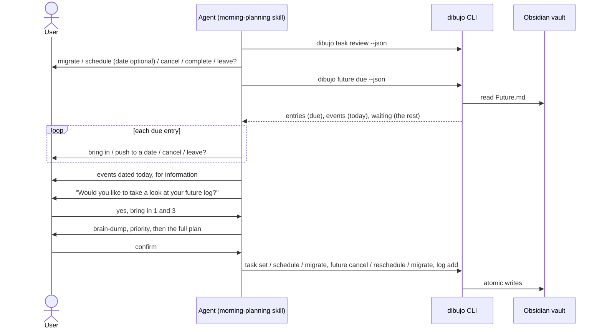

# Design: flat future log

## Overview

The future log becomes one plain note, `Future.md`, where every bullet is an entry. This design changes:

- `src/bujo/future.ts`: shrinks to parsing a flat note, appending, and classifying entries (due, today's events, waiting). The month, year, and chain-walking code goes away.
- `src/bujo/bullet.ts`, `types.ts`, `ref.ts`, `capture.ts`: an optional `📅` date on events, a future origin without a year, and a year-less ref.
- `src/vault/future.ts`: reads and writes the single note. Reschedule edits a date in place.
- `src/vault/tasks.ts`: `scheduleTask` takes an optional date and looks up its entry by origin.
- New commands `dibujo future add` and `dibujo future import`.
- The `morning-planning` skill (a new "look at the rest" step), a new `future-log` skill, and one paragraph each in `daily-log` and `morning-planning` about not editing the file by hand.

As before, the CLI makes no LLM calls and skills never touch vault files.



## Answers to the open questions in the requirements

| Question | Answer |
| --- | --- |
| Refs | `<line>:<fingerprint>`, for example `14:9c04e7d1`. See [Refs](#refs). |
| Origin link in code | `FutureOrigin` is `{ blockId, year? }`. `year` is set only when an old-form link is read, and only `future import` uses it. See [Links](#links). |
| Finding an entry from its daily task | A lookup in the one note for a task entry whose origin is `{ date, blockId }`. There are no chains to walk. |
| Where to read from | Commands read only `Future.md`. They look at the old `Future/` folder only to report `legacyNotes`, and `future import` reads it. |
| `📅` on events | Same trailing slot as `⏳`: after the tags, before the block id. Read and written on events only. |
| `--json` changes | Listed in [JSON changes](#json-changes). |

## Vault format

Version 1 stays. The future log has not been in a published release, so the only existing user of year notes is the author's vault, which `future import` carries over (Requirement 10.3).

### The future log note

Location: `<vault>/<folder>/Future.md`.

```markdown
---
dibujo: 1
type: future
---

- [ ] learn Rust
- [ ] book flights [[Bujo/Daily/2026-11-09#^q7r8s9|from 2026-11-09]] ⏳ 2026-12-20
- [>] renew passport [[Bujo/Daily/2026-11-09#^k3f9a1|from 2026-11-09]] ⏳ 2026-11-12 ^m4n5p6
* dentist at 3pm 📅 2026-12-12
- check out the zine fair in spring
```

- **Entries.** Every bullet below the frontmatter is an entry, wherever it is. Task, event, and note syntax, signifiers, and nesting are the same as in daily notes.
- **Headings.** Markdown headings are allowed anywhere and are ignored. They are never rewritten, and they don't end or start anything. A `## December` heading the user or an agent adds makes no difference to what is read.
- **Anything else** that isn't blank, a heading, or a bullet is kept and reported as unrecognized.
- **Order.** New entries go after the last non-blank line of the note, so the note reads in the order things were added. For a new note, a blank line goes between the frontmatter and the first entry.
- **A new note** is just the frontmatter. The template has no sections.

### Fields on a line

| Field | Markdown | Applies to |
| --- | --- | --- |
| Scheduled date | `⏳ 2026-12-20` | Tasks (unchanged) |
| Event date | `📅 2026-12-12` | Events only (new) |
| Origin link | `[[Bujo/Daily/2026-11-09#^k3f9a1\|from 2026-11-09]]` or `[[Bujo/Future#^m4n5p6\|from future log]]` | Tasks (the future form changes) |
| Block id | `^m4n5p6` | Any bullet (unchanged) |

- Order when written: text, origin link, tags, date, block id. Reading accepts any order.
- `📅` is read only on an event. On a task or a note it stays part of the text, so it never collides with the Tasks plugin's due date (Requirement 2.2).
- The date is not part of the fingerprint, like `⏳`, so changing it passes the edit check.

### Links

```ts
export interface DailyOrigin { date: string; blockId: string }     // unchanged
export interface FutureOrigin { blockId: string; year?: string }   // year: only from an old-form link
```

| Form | Markdown | Written |
| --- | --- | --- |
| Daily | `[[Bujo/Daily/2026-11-09#^k3f9a1\|from 2026-11-09]]` | Yes |
| Future | `[[Bujo/Future#^m4n5p6\|from future log]]` | Yes |
| Future, old | `[[Bujo/Future/2026#^m4n5p6\|from future log 2026]]` | No, read only |

Reading (`bullet.ts`): the regex stops requiring a date or year key and captures the whole link target instead, `\[\[([^[\]|#]+)#\^([A-Za-z0-9-]+)(?:\|[^[\]]*)?\]\]$`. A new `originFrom(target, blockId)` classifies the target:

| Target | Result |
| --- | --- |
| `YYYY-MM-DD`, or a path ending in `/Daily/YYYY-MM-DD` | daily origin |
| `Future`, or a path ending in `/Future` | future origin, no year |
| `YYYY` (bare), or a path ending in `/Future/YYYY` | future origin, with that year |
| Anything else, such as `Bujo/Daily/2026`, `Bujo/Future/2026-11-08`, `Books/2026` | not an origin. The link stays in the text. |

The rule is the same one as today, "the target and folder must agree", expressed on the whole target: a date needs `Daily` before it (or nothing), a year needs `Future` before it (or nothing), and the name `Future` stands alone. A bare `Future` with no folder is accepted, as bare dates are, for notes written without a folder.

**Known limit.** The parser doesn't know which folder is the dibujo folder, so `<path>` means any path. A task that ends with a block link to some other note named `Future`, such as `[[Books/Future#^abc]]`, is read as an origin link to the future log, and the link leaves the text. This is accepted: it needs a task that ends in a block link to a note with that exact name. Don't add a test that expects such a link to stay in the text.

Writing (`formatOriginLink`): the future form is `[[<folder>/Future#^id|from future log]]`, or `[[Future#^id|from future log]]` without a folder.

**Fingerprint.** A daily origin keeps hashing as `{ date, blockId }`, so daily refs don't change. A future origin hashes as `{ blockId }`, with the year left out. An old-form and a new-form link to the same block therefore give the same fingerprint.

**Does `[[Bujo/Future#^id]]` open the right note?** `Bujo/Future` is the note `Bujo/Future.md`. Obsidian links point at notes, not folders, so the old `Bujo/Future/` folder next to it should not matter. This is on the manual checks list.

## Refs

```
<line>:<fingerprint>      e.g. 14:9c04e7d1
```

- A future ref has two parts, so it can't be mistaken for a daily ref (`2026-11-09:7:ab12cd34`) or the old year form (`2026:14:ab12cd34`), which have three.
- The fingerprint ignores state, date, and block id. A ref survives every change dibujo makes to an entry, and a command is safe to run again.
- Resolution is unchanged: first the line and fingerprint, then the one entry with that fingerprint, else `TASK_NOT_FOUND`.
- Old year-form refs are rejected with `INVALID_REF`, and the hint tells the caller to run `dibujo future show` or `dibujo future due` for fresh refs. Refs only live for one session, so there is nothing to keep working.
- `ref.ts`: `FutureRef` is `{ line, fingerprint }`. `parseRef` and `parseFutureRef` point to each other in their error hints, as now.

## Pure logic

### `src/bujo/future.ts`

```ts
export interface FutureBullet extends ParsedBullet {}     // no month field

export interface ParsedFutureNote {
  version: number | null;
  entries: FutureBullet[];
  unrecognized: UnrecognizedLine[];
}

export function newFutureTemplate(): string;
export function parseFutureNote(content: string): ParsedFutureNote;
export function appendFutureEntries(original: string, addition: readonly string[]): string;

export function dueEntries<T extends FutureBullet>(entries: readonly T[], today: string): T[];
export function eventsOn<T extends FutureBullet>(entries: readonly T[], date: string): T[];
export function otherWaiting<T extends FutureBullet>(entries: readonly T[], today: string): T[];
```

- `parseFutureNote`: skips the frontmatter (using `findFrontmatterEnd`), skips blank lines and headings (a line starting with 1 to 6 `#` and a space), turns each bullet into an entry with its line number, and reports the rest as unrecognized.
- `appendFutureEntries`: inserts the lines after the last non-blank line, keeping the line ending style. It adds a blank line only when the last non-blank line is the end of the frontmatter. Like the current function, it checks that every original line is still there in order (`isSubsequence`) and throws if not.
- `dueEntries`: unchanged. Waiting task, with a `⏳` date on or before today, by date and then note order.
- `eventsOn`: events whose `📅` date equals the date, in note order.
- `otherWaiting`: waiting tasks that aren't due, meaning undated or dated after today, in note order.
- **Removed:** `monthOf`, `monthHeading`, `monthSections`, `findLive`, the `LiveEntry` and `LocatedEntry` types, and the month constants.

### `src/bujo/future-input.ts` (new)

The input for `future add`, validated with zod, with the same text rules as `log add` (`BulletText`).

```ts
export const FutureEntryInput = z.object({
  type: z.enum(BULLET_TYPES),
  text: BulletText,
  signifiers: z.array(z.enum(SIGNIFIERS)).default([]),
  date: z.string().regex(/^\d{4}-\d{2}-\d{2}$/).optional(),
}).strict();   // a note with a date is rejected in a superRefine

export const FutureAddInput = z.object({ entries: z.array(FutureEntryInput).min(1) }).strict();

export function parseFutureAdd(json: string): FutureEntryInput[];            // INVALID_INPUT with field paths
export function planAdd(existing: readonly FutureBullet[], input: readonly FutureEntryInput[],
                        today: string, folder?: string): { lines: string[]; skipped: number };
```

- `planAdd` rejects a date earlier than `today` with `INVALID_DATE`, and turns each entry into a bullet line: a task gets `scheduled`, an event gets `eventDate`, and none get a state other than open, an origin, or a block id.
- **Duplicates.** The key is `type`, `text`, the sorted signifiers, and the date (or none). The existing keys come from entries that are still waiting: open tasks, and all events and notes. An input entry whose key is already there is skipped, and so is a repeat within the same input.
- Nothing is written if any entry is invalid.

`BulletText` also rejects text that contains `📅`, the same way it rejects `⏳`. This stops a daily-log bullet from carrying a date field by accident.

### `src/bujo/future-import.ts` (new)

```ts
export interface OldNote { year: string; path: string; content: string }

export interface ImportPlan {
  lines: string[];                       // lines to append to Future.md, in order
  copied: { path: string; count: number }[];
  unreadable: { path: string; line: number; text: string }[];
}

export function planImport(old: readonly OldNote[], current: ParsedFutureNote): ImportPlan;
```

The old notes are read with the same flat parser (`parseFutureNote`). That is more tolerant than the old month parser on purpose: entries under a heading the old parser didn't recognize (the `## December` case) are found too.

Rules, oldest year first and then note order:

1. **What is copied.** Open tasks, events, and notes. Tasks in any other state are skipped. A bullet nested under a skipped entry is skipped too.
2. **Origins are flattened.** In the old notes, a rescheduled task is a chain: the waiting entry links to a `[<]` entry, which links to an earlier one, and so on to a daily task. For a copied task whose origin is a future origin with a year, the plan follows the chain through the old entries (matched by year and block id, with a visited set against loops) and uses the origin of its end. If that is a daily origin, the copy gets the daily link. If the chain breaks, the copy keeps the link it had. This is what lets `task schedule` find the imported entry later, and lets `future due` say which day a task was scheduled from.
3. **Block ids.** A copied line keeps its block id unless `Future.md` or an earlier copied line already uses it, in which case the id is dropped. A waiting entry rarely has one.
4. **Already imported.** A copy is skipped when an entry with the same fingerprint (after flattening) is already in `Future.md`, in any state. That is what makes a second run add nothing, even after the user has brought the imported entry in or cancelled it.
5. **Lines copied.** An entry that changes (a flattened origin or a dropped id) is formatted again with `formatBullet`. Any other entry is copied byte for byte.
6. **Unreadable.** Lines in the old notes that aren't blank, headings, or bullets are listed in `unreadable` and not copied.

## Vault operations

### `src/vault/paths.ts`

- `futureNotePath(config)` returns `Future.md` in the dibujo folder.
- `legacyFutureNotePaths(config)` lists the `Future/YYYY.md` files, oldest year first. A missing folder gives an empty list.

### `src/vault/future.ts`

```ts
loadFutureNote(config): LoadedFutureNote | null          // checks the format version
resolveEntry(note, ref): ResolvedEntry                    // by line + fingerprint, else unique fingerprint
showFuture(config): FutureShowView
dueFor(config, today): DueResult
addEntries(config, input, { now, dryRun, hooks }): AddResult
migrateEntry(config, ref, options): MigrateEntryResult
rescheduleEntry(config, ref, date, options): RescheduleEntryResult
cancelEntry(config, ref, options): CancelEntryResult
importOldNotes(config, options): ImportResult
legacyNotesToImport(config): string[]
```

- **One note.** Everything loads `Future.md` once, checks the format version, and (for writes) goes through `commitWrites` with the original content, so `NOTE_CHANGED` works as it does for daily notes. `LoadedFutureNote` loses its `year`.
- **`dueFor`** returns the existing `entries` (each with `ref`, `text`, `signifiers`, `scheduled`, `daysOverdue`, `scheduledFrom`, `path`), plus `events` and `waiting`. `scheduledFrom` is the entry's origin date when its origin is daily, and `null` otherwise. The cross-note walk is gone.
- **`addEntries`:** loads the note (or starts from the template), runs `planAdd`, appends with `appendFutureEntries`, and writes. The result lists the entries added, with their refs, which are computed by parsing the result.
- **`migrateEntry`:** as today, with the year removed. The entry becomes `[>]` with a block id, written first. The daily copy has the origin `{ blockId }`. A copy that already exists is found by a future origin with that block id, so a rerun adds no second copy.
- **`rescheduleEntry`:** the entry must be open (`TASK_NOT_OPEN` otherwise) and the date later than today (`INVALID_DATE`). The line gets its `⏳` date set or changed with `setScheduled`, and the edit goes through `applyLineEdits`, which refuses anything but a date change. The same date is reported as `unchanged`. The `[<]` daily task is left alone, since it records when the task was first scheduled.
- **`cancelEntry`:** as today, with the year removed.
- **`importOldNotes`:** reads every old note (an unsupported version stops it, naming the note), runs `planImport` against `Future.md`, and appends the lines in one write. `--dry-run` prints the resulting note.
- **`legacyNotesToImport`:** runs `planImport` without writing and returns the paths of the old notes that would still add something. `show` and `due` call it to fill in `legacyNotes`. It ignores old notes it can't read, so a bad old note never stops `show` or `due`.

### `src/vault/tasks.ts`: `scheduleTask(config, ref, date?, options)`

1. Resolve the task. It must be open or already scheduled (`TASK_NOT_OPEN` otherwise).
2. When a date is given, it must be after the task's note date (`INVALID_DATE`), as now.
3. Check the link-safe folder, load `Future.md` (checking its version), and get the task's block id, or make one.
4. Edit the daily line: `[<]` and the block id as now, and `⏳` only when a date is given. A task that already has a `⏳` date keeps it when no date is given.
5. Look up the entry: a task entry in `Future.md` whose origin is `{ date: task.date, blockId }`.

| Entry found | Date given | Future log action |
| --- | --- | --- |
| None | any | **Add** a waiting entry, with the date if given. `action: "added"` |
| Open | different from the entry's | **Change the date** in place. `action: "rescheduled"` |
| Open | same, or none | Nothing. `action: "unchanged"` |
| Brought in, cancelled, or done | any | Nothing. `action: "unchanged"` |

6. Write the daily note first and the future log second. A rerun after an interruption finds the block id in the daily note, finds no entry, and adds it, so nothing is duplicated.

`task schedule` takes the date as an optional argument. The result's `future` field keeps `path`, `action`, and `status`, and loses `year`.

## CLI

New files in `src/cli/`, registered in `registers.ts`:

| File | Command |
| --- | --- |
| `future-add.ts` | `dibujo future add [--dry-run] [--json]`, JSON on stdin |
| `future-import.ts` | `dibujo future import [--dry-run] [--json]` |

`future-add.ts` follows `log-add.ts`: it fails with `USAGE` when stdin is a terminal and reads input through `ctx.readStdin()`.

```sh
echo '{"entries":[
  {"type":"event","text":"dentist at 3pm","date":"2026-12-12"},
  {"type":"task","text":"learn Rust"},
  {"type":"note","text":"check out the zine fair"}
]}' | dibujo future add --json
```

Changed files: `future-show.ts`, `future-due.ts`, `future-migrate.ts`, `future-reschedule.ts`, `future-cancel.ts`, `task-schedule.ts` (optional `[date]`), and `bullet-symbols.ts` (prints `future log` without a year, and a `📅` suffix for event dates).

### JSON changes

All other fields are unchanged. These are the exceptions Requirement 10.4 asks the design to list.

| Command | Change |
| --- | --- |
| `future due` | **Added:** `events`, `waiting`, `legacyNotes` |
| `future show` | **Removed:** `year`, `months`. **Added:** `entries` (flat, in note order, with a `date` field), `legacyNotes` |
| `future reschedule` | **Removed:** `from`, `to`, `fromContent`, `toContent`. **Added:** `ref`, `path`, `scheduled`, and `content` on a dry run. `status` is `rescheduled` or `unchanged` |
| `future migrate` | **Removed:** `source.year` |
| `future cancel` | **Removed:** `year` |
| `task schedule` | **Removed:** `future.year`. `scheduled` is absent when no date was given |
| `future add`, `future import` | New |

Installed `morning-planning` skills that read `data.to.date` after `future reschedule` need the updated skill. `dibujo skills install` updates it.

## Skills

### `morning-planning`

The steps become: CLI, review yesterday, migration, due future log entries, today's events, the rest of the future log, brain-dump, priority, confirm, save, report. Changes:

- **Migration:** when the user schedules a task and gives no date, ask once, "Is there a date for it, or just the future log?" A "no" runs `task schedule <ref> --json` with no date.
- **Due entries:** unchanged, except that "push" says the date is changed in place.
- **Events:** if `data.events` isn't empty, one message lists them: "On today: dentist at 3pm." No question.
- **The rest:** if `data.waiting` isn't empty, ask once, "Would you like to take a look at your future log?" On yes, show the tasks as a numbered list with their dates if any, and ask which to bring into today, with "none" as an answer. The user may also name one to give a date or cancel. On no, skip.
- **Refs.** `future due` is read once, in the due entries step, and its refs are used in the save step. This is safe because nothing is written before the save, and the only appends to `Future.md` (from `task schedule`) go to the end, so lines above them don't move. The fingerprint is the fallback.
- **Priority** also applies to tasks picked from the list.
- **Report:** `future reschedule` is reported from `data.status` and `data.scheduled`.

### `future-log` (new)

Frontmatter `name: future-log` and a `description` that says it adds to and reads the future log, with triggers like "put X on my future log", "remind me in March", and "what's in my future log?".

1. Find the CLI (the same first step as the other skills).
2. Turn what the user said into entries: tasks for things to do, events for things on a date, notes for thoughts. Keep the user's words and keep them short.
3. Dates: only when the user hints at one. Work out `YYYY-MM-DD`. For a month only ("in March"), ask for a day, and if there isn't one add the entry undated, without the month in the text.
4. Show what will be added in Bullet Journal symbols and ask for confirmation.
5. Save with `dibujo future add --json` and a quoted heredoc, as `morning-planning` does for `log add`. Report from `data.added` and `data.skipped`, and don't claim success unless `"ok": true`.
6. Reading: `dibujo future show --json`. Changing: `future reschedule` (give a date or change it), `future migrate` (bring into today), `future cancel`.
7. If `legacyNotes` isn't empty, tell the user and offer to run `dibujo future import`.

### `daily-log` and `morning-planning`

Each gets a short rule: the future log is changed only through `dibujo` commands, never by editing `Future.md` or anything under `Future/`, and requests to add something to it use the `future-log` skill. `skills install` picks up the new skill with no code change, because it copies every folder under `skills/` that has a `SKILL.md`.

## Moving the old notes

`dibujo future import` is a one-time step, and `show` and `due` tell the user to run it while there is something to copy. It never changes the old notes, so links in daily notes that point to them keep resolving in Obsidian. The old `Future/` folder can be archived or deleted by the user whenever they like.

For the author's vault this copies the three tasks currently in `Future/2026.md`, and any waiting entries that `task schedule` wrote. They keep their daily links.

## Format document

`docs/vault-format.md` changes:

- "Where notes live" and "Future log": `Future.md`, no years, no months.
- The example, frontmatter table, entries, states (the `[<]` row says dibujo reads it and never sets it), dates (`⏳` and `📅`), and due entries.
- The "Task fields" table and the notes on origin links: the new future form, and the old form as read-only.
- "Scheduling and coming back": `task schedule` with an optional date, reschedule in place.
- "How dibujo writes to a note": appends go after the last non-blank line.
- A short section on `future import` and old year notes.
- "Versioning": still 1, and why.

## Error handling

No new error codes. Reused: `INVALID_INPUT` (bad JSON, unknown field, note with a date), `INVALID_DATE` (past date, bad format), `INVALID_REF` (old ref shape), `TASK_NOT_FOUND`, `NOT_A_TASK`, `TASK_NOT_OPEN`, `NOTE_CHANGED`, `NOTE_VERSION_UNSUPPORTED`, `CONFIG_INVALID` (link-unsafe folder).

## Testing

Limited to the core logic, as the spec says. Obsolete tests are deleted, not ported.

| Area | Tests |
| --- | --- |
| `bullet.ts` | `📅` read on events only and left in the text on tasks and notes. All three origin forms read, with the folder-agreement cases. A future origin is written without a year. Daily fingerprints don't change. Old and new future links share a fingerprint. Property tests: round trip with the new arbitraries (a future origin and an event date). |
| `ref.ts` | The two-part ref round trip, and the rejected daily and year-form refs. |
| `future.ts` (pure) | Flat parsing with headings, nesting, and unrecognized lines. Appending, including the blank line after the frontmatter, CRLF, and the original lines kept. `dueEntries`, `eventsOn`, `otherWaiting`. |
| `future-input.ts` | Validation, past dates, notes with dates, duplicates in the note and in the input. |
| `future-import.ts` | What is copied and skipped, flattening a chain, a broken chain, id collisions, running twice, and the `## December` case. |
| `vault/tasks.ts` | `scheduleTask` for every row of the table above, plus an interrupted run. |
| `vault/future.ts` | `rescheduleEntry` in place and refused edits, `migrateEntry` rerun, `dueFor` fields. |
| `cli` | One whole cycle: add, schedule, due, migrate, reschedule, cancel, import. |
| `docs` | The updated `vault-format.md` examples parse. |

Not tested: the skills (manual, as before).

**Manual checks** are added to the tasks file: a link to `Bujo/Future` opens `Future.md` in Obsidian with the old `Future/` folder next to it, the backlinks pane, and a morning-planning run in a real agent.

## Files

| Area | Files |
| --- | --- |
| Pure logic | `src/bujo/bullet.ts`, `types.ts`, `ref.ts`, `capture.ts`, `future.ts` (rewritten), `future-input.ts` and `future-import.ts` (new) |
| Vault | `src/vault/paths.ts`, `future.ts` (rewritten), `tasks.ts` |
| CLI | `src/cli/future-*.ts`, `future-add.ts` and `future-import.ts` (new), `task-schedule.ts`, `bullet-symbols.ts`, `registers.ts` |
| Skills and docs | `skills/future-log/SKILL.md` (new), `skills/daily-log/SKILL.md`, `skills/morning-planning/SKILL.md`, `docs/vault-format.md` |
| Tests | the rows above, and `tests/helpers/arbitraries.ts` |
