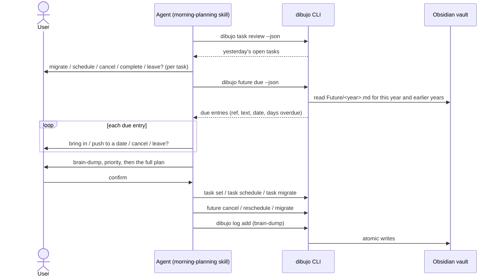

# Design: future log

## Overview

The future log is a yearly note that holds tasks scheduled for later dates. This design adds:

- `src/bujo/future.ts`: pure logic for the future log note (template, parsing, appending, due entries).
- `dibujo future show | due | migrate | reschedule | cancel`: commands that read the future log and handle its entries.
- An extension to `dibujo task schedule`, which now also writes the task into the future log.
- A new step in the `morning-planning` skill for due entries.

As before, the CLI makes no LLM calls and the skill never touches vault files. The skill runs the conversation, and the CLI reads notes and writes the agreed changes.



## Answers to the open questions in the requirements

| Question | Answer |
| --- | --- |
| Link syntax | The origin link gets a second form that points at a future log note by year. It is described in [Links](#links). Daily links keep their current form. |
| Month headings | `## 2026-12 December`. A new note is created with all 12 months, so entries can be added by hand. A missing month is inserted in calendar order. |
| Refs | `YYYY:<line>:<fingerprint>`, for example `2026:14:9c04e7d1`. Daily refs don't change. |
| Commands | A new `future` group. `task schedule` stays where it is. |
| Streaks | Only a link to the previous day's daily note extends a streak. A link to the future log ends it, so a returned task starts at 0. |

## Vault format

Version 1 stays. The additions are optional, and a daily note without them is still valid (see [Format version](#format-version)).

### The future log note

Location: `<vault>/<folder>/Future/YYYY.md`. The file name is the year, and it decides which year a note covers.

```markdown
---
dibujo: 1
type: future
year: 2026
---

## 2026-01 January

## 2026-11 November

- [>] renew passport [[Bujo/Daily/2026-11-09#^k3f9a1|from 2026-11-09]] #priority ⏳ 2026-11-12 ^m4n5p6

## 2026-12 December

- [ ] book flights [[Bujo/Daily/2026-11-09#^q7r8s9|from 2026-11-09]] ⏳ 2026-12-20
- [<] file taxes [[Bujo/Daily/2026-11-02#^t1u2v3|from 2026-11-02]] ⏳ 2026-12-01 ^w4x5y6
- [ ] file taxes [[Bujo/Future/2026#^w4x5y6|from future log 2026]] ⏳ 2026-12-15
```

(The other months are in the file too. They are left out here.)

- **Months.** There is one `## YYYY-MM <Month name>` section per month, in calendar order. A heading is recognized by the `YYYY-MM` at its start. The month name is for people, and the English names are fixed in code so output doesn't depend on the computer's locale.
- **Entries.** Entries are ordinary bullets under a month heading. For this spec they are tasks. They use the same line format as daily notes, in the same field order: text, origin link, tags, `⏳` date, block id.
- **States.** `[ ]` waiting, `[>]` brought into a daily log, `[<]` rescheduled, `[-]` cancelled. The CLI never writes `[x]`, but it reads one the user typed.
- **Dates.** A dated entry's `⏳` date decides when it is due. Its section is only for reading. If the user moves an entry to another month by hand, or changes its date, dibujo goes by the date and leaves the line where it is (Requirement 1.6).
- **Undated entries.** An entry with no `⏳` date is valid and kept. It is never due. The monthly migration spec handles it.
- **Everything else.** Lines under a month heading that aren't bullets are reported as unrecognized and kept. Text outside the month sections (a `# Notes` heading, a paragraph at the top) is never read or changed. Bullets outside the month sections aren't entries.

Why one section per month, all created up front: it matches the paper spread, and it lets the user type into any month in Obsidian without a heading having to exist first. The cost is 12 mostly empty headings.

### Links

The origin link already points from a migrated daily task to the daily task it came from. This spec adds a second target, a task in a future log note, so `Origin` has two forms:

```ts
export type Origin = DailyOrigin | FutureOrigin;
export interface DailyOrigin { date: string; blockId: string }   // unchanged
export interface FutureOrigin { year: string; blockId: string }  // new, year is "2026"
```

| Form | Markdown | Where it is used |
| --- | --- | --- |
| Daily | `[[Bujo/Daily/2026-11-09#^k3f9a1\|from 2026-11-09]]` | A future log entry linking back to its daily task, and a migrated daily task (unchanged) |
| Future | `[[Bujo/Future/2026#^m4n5p6\|from future log 2026]]` | A daily copy linking to the entry it came from, and a rescheduled entry linking to the old one |

Reading (`TRAILING_ORIGIN` in `src/bujo/bullet.ts`): the pattern accepts a key that is either `YYYY-MM-DD` or `YYYY`, after an optional path.

```
\s+\[\[([^[\]|#]*?)(\d{4}-\d{2}-\d{2}|\d{4})#\^([A-Za-z0-9-]+)(?:\|[^[\]]*)?\]\]$
```

- A key of the form `YYYY-MM-DD` is a daily link. The path before it must be empty or end in `Daily/`.
- A key of the form `YYYY` is a future link. The path before it must be empty or end in `Future/`.
- Anything else, such as `[[Books/2026#^abc]]`, stays part of the text, as it does today.
- The alias after `|` is ignored, so the label can be edited.
- Fields can still come in any order at the end of the line.

Writing (`formatOriginLink`): the future form needs the folder, like the daily form. Without a folder, both forms use the note's file name only (`[[2026#^id|from future log 2026]]`).

`fingerprint()` keeps the same JSON for a daily origin (`{ date, blockId }`) and uses `{ year, blockId }` for a future origin. **Existing daily refs therefore don't change.**

### Format version

The version stays at 1 (Requirement 6.3).

- The future log is a new note type with `type: future`. No older CLI reads or writes the `Future/` folder.
- Daily notes only gain two optional things: the future link form, and a block id on a scheduled task. Both are optional.
- A CLI from before this spec that reads a daily note with a future link would keep the link as plain text, because its path doesn't end in `Daily/`. Nothing breaks. There is no older install to worry about.

`docs/vault-format.md` gets a "Future log" section covering the note, the entry states, both link forms, and the rule for a due entry. The doc test parses the new examples.

## Refs for future log entries

```
<year>:<line>:<fingerprint>      e.g. 2026:14:9c04e7d1
```

- `year` is the year of the note's file name. `line` is the 1-based line. `fingerprint` is `fingerprint(bullet)` from `src/bujo/bullet.ts`, as for daily refs.
- The fingerprint ignores state, `⏳` date, and block id. A ref therefore survives every change dibujo makes to an entry, and the same command is safe to run again (Requirements 2.5, 4.5, 4.9).
- Because the fingerprint includes the origin, two entries with the same text from different tasks never share a ref.
- The ref is resolved like a daily ref: first by line and fingerprint, then by looking for the one entry with that fingerprint, and otherwise `TASK_NOT_FOUND`.

A daily ref and a future ref look different (`2026-11-09:7:…` against `2026:14:…`). `src/bujo/ref.ts` gets `formatFutureRef` and `parseFutureRef`, and `parseRef` stays as it is. Giving a daily ref to a `future` command, or the other way around, fails with `INVALID_REF`, and the hint says which command lists the right kind of ref.

## Pure logic: `src/bujo/future.ts`

```ts
export interface FutureBullet extends ParsedBullet { month: string }   // "2026-12", from its heading

export interface ParsedFutureNote {
  version: number | null;
  entries: FutureBullet[];
  unrecognized: UnrecognizedLine[];
}

export function newFutureTemplate(year: string): string;
export function parseFutureNote(content: string): ParsedFutureNote;
export function appendFutureEntries(original: string, month: string, lines: readonly string[]): string;
export function dueEntries(entries: readonly FutureBullet[], today: string): FutureBullet[];
export function findLive(entries: readonly LocatedEntry[], from: Origin): LiveEntry | null;
```

- **`newFutureTemplate`** writes the frontmatter and the 12 month sections.
- **`parseFutureNote`** reads the version the same way `parseDailyNote` does. For the body, it reads each bullet under a `## YYYY-MM …` heading as an entry, and reports other non-blank lines in those sections as unrecognized. Headings inside code fences are ignored.
- **`appendFutureEntries`** puts the lines after the last non-blank line of the month's section. If the month's heading is missing, it adds the heading in calendar order: before the first later month, otherwise after the last month section, otherwise at the end of the note. It checks, as `appendCapture` does, that every original line is still there in order.
- **`dueEntries`** keeps task entries in state open that have a `⏳` date on or before today. It sorts them by date, then by position.
- **`findLive`** answers "is there a live entry for this task?" See [Scheduling](#scheduling-a-task).

To share the parsing and appending code with daily notes, `src/bujo/note.ts` exports `findFrontmatterEnd` and `readVersion`, and its heading scan and `appendToSection` take a section range instead of a fixed section name. Daily-note behavior doesn't change, and the existing note tests cover it.

Line edits use the existing `applyLineEdits`, which already refuses any change beyond the checkbox, the `⏳` date, and the block id.

## Scheduling a task

`scheduleTask` in `src/vault/tasks.ts` now plans up to three writes, and does them in this order.

1. **The daily note.** The task becomes `[<]`, gets its `⏳` date, and gets a block id if it has none. This is the existing edit plus `addBlockId`.
2. **The future log.** One of the cases below.

| State of the future log | What is written |
| --- | --- |
| No entry for this task | A new waiting entry is added to the date's month, linking to the daily task |
| A waiting entry with the same date | Nothing. The command reports the future log as unchanged |
| A waiting entry with a different date | The entry is rescheduled (see [Handling entries](#handling-entries)), and the daily note's date is replaced as it is today |
| The task's entries were all handled | A new waiting entry is added, linking to the daily task |
| An interrupted reschedule (the old entry is `[<]` with a block id and has no copy) | The new entry is added, linking to the old entry |

To find "the entry for this task", `findLive` starts from the task's origin (`{ date, blockId }`) and looks at the entries that link to it. If such an entry is waiting, that is the live entry. If it is `[<]`, `findLive` follows the entries that link to it, and so on. A visited set stops the walk if a hand edit creates a loop. All future log notes are read, because the entry can be in any year.

Rules around that:

- **Order and recovery.** The daily note is written first, then the future log. If scheduling stops between the two, running the same `task schedule <ref> <date>` again finds no entry, adds it, and reports the daily note as unchanged (Requirements 2.5 and 2.6). Tasks scheduled before this spec are fixed the same way.
- **Nested bullets.** Only the task is written. Its children stay in the daily note (Requirement 2.3).
- **Checks before writing.** Every note that will be written is read and its version checked before the first write, including a future log note that doesn't exist yet. If any check fails, nothing is written (Requirement 2.8).
- **Dry run.** Both resulting notes are returned.

## Reading and due entries

`src/vault/future.ts` holds the file access:

```ts
export function futureNotePath(config, year): string;          // in vault/paths.ts
export function readFutureNote(config, year): FutureNoteView;
export function loadFutureNotes(config, { throughYear? }): LoadedFutureNote[];
export function dueEntriesFor(config, today: string): DueResult;
```

- **`loadFutureNotes`** lists `<folder>/Future/`, keeps names that match `YYYY.md`, reads each, and checks its version. A missing folder gives an empty list. A note with an unsupported version throws `NOTE_VERSION_UNSUPPORTED` with that note's path. Nothing is skipped, because a skipped note would hide entries that must keep coming back (Requirement 3.9).
- **`dueEntriesFor`** loads the notes for today's year and every earlier year, runs `dueEntries`, and builds the result. Because a waiting entry stays waiting until it is handled, it is listed again each day. Nothing else is needed for Requirement 3.5.
- **`scheduledFrom`** is the date of the daily note that the entry started from. It follows `FutureOrigin` links across the loaded notes until it reaches a `DailyOrigin`. The walk has a visited set. If the chain breaks, the value is `null`.
- **`daysOverdue`** is the number of calendar days from the entry's date to today (0 on the day itself). `journal-date.ts` gets a `daysBetween(from, to)` helper that uses the same noon anchoring as `addDays`.

## Handling entries

All three actions take a future ref. Each one reads the notes it will touch, checks their versions, and then writes. They share a small helper, `commitWrites(writes)`, in `src/vault/write-plan.ts`. A write is `{ path, original, content, hooks }`. A write with `original === null` goes through `writeNew`, a changed one goes through `replaceIfUnchanged`, and an unchanged one is skipped. The helper returns each note's status.

### Migrate to a daily log

`future migrate <ref> [--to <date>] [--priority]`

1. **Source first.** The entry becomes `[>]` and gets a block id if it has none.
2. **Target second.** An open task is appended to the target daily note's Log, with the entry's text and signifiers (plus `priority` with `--priority`), no `⏳` date, and a future link to the entry.

The target defaults to today's journal date and must be today or later (`INVALID_DATE` otherwise). An entry can be brought in before its date.

| Interrupted after | State on disk | Running the same command again |
| --- | --- | --- |
| Nothing written | Entry waiting | Full migration |
| The source write | Entry `[>] … ^id`, no copy in the target | The ref still resolves, so the copy is added |
| Both writes | Done | Both notes unchanged |

The entry is accepted when it is waiting, or when it is `[>]` with a block id (a resumed migration). The target is checked for a task whose origin is `{ year, blockId }`. If it exists, the target is unchanged.

### Reschedule

`future reschedule <ref> <date>`

1. **Old entry.** It becomes `[<]` and gets a block id.
2. **New entry.** It is appended to the month of the new date, in that year's note, with the same text and signifiers, the new `⏳` date, and a future link to the old entry.

The new date must be later than today.

- **Same year.** Both changes go into one write to the note, so there is no gap to recover from.
- **A different year.** The old note is written first and the new note second. An interrupted run is finished by running the same command again. The old entry is `[<]` with a block id and has no copy, so only the new entry is added.
- **Run again after it finished.** The old entry is `[<]` and a copy exists, so everything is unchanged. This also holds if the second run names a different date, because the entry has already been moved once. The result reports the existing copy.

### Cancel

`future cancel <ref>` marks a waiting entry `[-]`. A cancelled entry gives `unchanged`. A handled entry in any other state gives `TASK_NOT_OPEN`.

## Streaks

`migrationStreak` in `src/vault/tasks.ts` only follows `DailyOrigin` links to the day before. A `FutureOrigin` link ends the streak, as any other link that doesn't point at the previous day does. A task that comes back from the future log therefore has a streak of 0, and migrates normally from then on (Requirement 4.8).

The change in code is a narrowing check on the origin (`"date" in origin`), and the same check in `migrateTask`'s duplicate test.

## CLI

### Commands

| Command | Purpose | Requirement |
| --- | --- | --- |
| `dibujo future show [--year <YYYY>] [--json]` | Read a year's future log | 3.1, 3.2 |
| `dibujo future due [--date <YYYY-MM-DD>] [--json]` | List due entries | 3.3 to 3.9 |
| `dibujo future migrate <ref> [--to <YYYY-MM-DD>] [--priority] [--dry-run] [--json]` | Bring an entry into a daily log | 4.1 |
| `dibujo future reschedule <ref> <YYYY-MM-DD> [--dry-run] [--json]` | Move an entry to a later date | 4.2 |
| `dibujo future cancel <ref> [--dry-run] [--json]` | Cancel an entry | 4.3 |
| `dibujo task schedule <ref> <YYYY-MM-DD> [--dry-run] [--json]` | Existing command, now also writes the future log | 2 |

`future due --date` names "today", like `task review --date`. The other commands use the current journal date.

### JSON output

`future due`:

```jsonc
{
  "ok": true,
  "data": {
    "today": "2026-12-03",
    "entries": [
      {
        "ref": "2026:14:9c04e7d1",
        "text": "book flights",
        "signifiers": [],
        "scheduled": "2026-12-01",
        "daysOverdue": 2,
        "scheduledFrom": "2026-11-09",   // null when the chain can't be followed
        "path": "/…/Bujo/Future/2026.md"
      }
    ]
  }
}
```

`future show`: months that have entries are listed, in order.

```jsonc
{
  "ok": true,
  "data": {
    "exists": true, "path": "/…/Bujo/Future/2026.md", "year": "2026",
    "months": [
      { "month": "2026-12", "entries": [
        { "ref": "2026:14:9c04e7d1", "line": 14, "type": "task", "state": "open", "text": "book flights",
          "signifiers": [], "depth": 0, "scheduled": "2026-12-20",
          "origin": { "date": "2026-11-09", "blockId": "q7r8s9" } } ] }
    ],
    "unrecognized": []
  }
}
```

`future migrate`:

```jsonc
{ "ok": true, "data": {
    "status": "migrated" | "unchanged",
    "source": { "path", "year", "status": "updated" | "unchanged" },
    "target": { "path", "date", "status": "created" | "updated" | "unchanged" },
    "dryRun": false
    // dry run only: "sourceContent", "targetContent"
} }
```

`future reschedule`:

```jsonc
{ "ok": true, "data": {
    "status": "rescheduled" | "unchanged",
    "from": { "path", "year", "status": "updated" | "unchanged" },
    "to":   { "path", "year", "date", "status": "created" | "updated" | "unchanged" },
    "dryRun": false
    // dry run only: "fromContent", "toContent"
} }
```

`future cancel`: `{ "status": "updated" | "unchanged", "ref", "path", "year", "state": "cancelled", "dryRun" }`.

`task schedule` gains one field and keeps the rest of its output, so nothing that reads it breaks:

```jsonc
{ "status": "updated", "ref", "path", "date", "state": "scheduled", "scheduled": "2026-12-01", "dryRun": false,
  "future": { "path", "year", "action": "added" | "rescheduled" | "unchanged", "status": "created" | "updated" | "unchanged" }
  // dry run only: "content" (daily note, as today) and "futureContent"
}
```

`log show` bullets keep their shape. A future origin appears as `{ "year", "blockId" }`, next to the existing `{ "date", "blockId" }` form.

Human output uses the existing symbols. A daily copy shows `↩ future log 2026`, and a due entry shows `⏳ 2026-12-01 (2 days overdue)`.

### Errors

No new error codes. The existing ones are used:

| Code | When |
| --- | --- |
| `INVALID_REF` | A ref has the wrong shape, or is the other kind of ref |
| `TASK_NOT_FOUND` | No single entry matches the ref, or its note is missing |
| `NOT_A_TASK` | The ref points to an event or a note |
| `TASK_NOT_OPEN` | `migrate` or `reschedule` on an entry that isn't waiting (or resumable), or `cancel` on one that is handled |
| `INVALID_DATE` | A bad date, `reschedule` to a date that isn't later than today, or `migrate --to` a date in the past |
| `NOTE_VERSION_UNSUPPORTED` | Any note the command reads or will write has a newer version. The message names the note. |
| `NOTE_CHANGED` | A note changed between the read and the write |
| `CONFIG_INVALID` | The folder name contains `[`, `]`, `|`, `#`, or `^`, which would break the links. This is checked before writing, as for `task migrate`. |

## The `morning-planning` skill

`skills/morning-planning/SKILL.md` is updated. The steps become: find the CLI, review yesterday, migration, **due future log entries**, brain-dump, priority, confirm, save, report.

**Due entries** (new, after migration):

1. Run `dibujo future due --json`. If `data.entries` is empty, say nothing and go on.
2. Go through the entries one at a time. Show the text and its date. When `daysOverdue` is above 0, say so in a neutral way ("This was due 2 days ago."), without recommending an answer.
3. Ask what to do:

| User says | Choice | Command in the save step |
| --- | --- | --- |
| "bring it in", "today", ">" | Bring into today | `dibujo future migrate <ref> --json` |
| "push it", "later", "<", a date | Push to a date. Ask for the date if missing. It must be after today. | `dibujo future reschedule <ref> <YYYY-MM-DD> --json` |
| "drop", "cancel" | Cancel | `dibujo future cancel <ref> --json` |
| "leave", "skip", "not yet" | Leave for now | none. It shows up again tomorrow. |

4. "skip" skips the rest of the step.

**Other changes:**

- **Priority.** The user can name entries they are bringing in. Those get `--priority`.
- **Confirm.** The plan gets a section for the future log, in the same symbols (`>` brought in, `<` pushed, `~` cancelled).
- **Save order.** `task set` and `task schedule`, then `task migrate`, then `future cancel`, `future reschedule`, and `future migrate`, then `log add`. The retry rules are unchanged.
- **Brain-dump duplicates.** The skill also leaves out bullets that match an entry being brought in.
- **Scheduling yesterday's task.** The skill tells the agent that `task schedule` also writes the future log, so the user isn't asked twice.

The skill still doesn't mention how it was started. `skills install` copies the changed skill, because its content hash changes.

## Module layout

```
src/
├── bujo/
│   ├── types.ts           # Origin = DailyOrigin | FutureOrigin
│   ├── bullet.ts          # both link forms in TRAILING_ORIGIN, formatOriginLink, fingerprint
│   ├── note.ts            # export findFrontmatterEnd/readVersion; appendToSection takes a range
│   ├── future.ts          # NEW: template, parse, append, due entries, findLive
│   ├── ref.ts             # + formatFutureRef, parseFutureRef
│   └── journal-date.ts    # + daysBetween
├── vault/
│   ├── paths.ts           # + futureNotePath
│   ├── daily.ts           # assertSupported accepts anything with a version
│   ├── write-plan.ts      # NEW: commitWrites
│   ├── future.ts          # NEW: load, read, due, migrate, reschedule, cancel
│   └── tasks.ts           # scheduleTask writes the future log; streak and duplicate checks narrow the origin
├── cli/
│   ├── future.ts          # NEW: `future` group
│   ├── future-show.ts     # NEW
│   ├── future-due.ts      # NEW
│   ├── future-migrate.ts  # NEW
│   ├── future-reschedule.ts # NEW
│   ├── future-cancel.ts   # NEW
│   ├── task-schedule.ts   # prints the future log result
│   ├── bullet-symbols.ts  # shows ↩ future log <year>
│   └── registers.ts       # + registerFuture
skills/morning-planning/SKILL.md   # updated
docs/vault-format.md               # future log section
```

Dependencies still point one way: `cli` → `vault` → `bujo`. `src/bujo/future.ts` is pure. File listing and writes stay in `src/vault/`.

## Testing strategy

All tests use `vitest --run` with temp vaults and a fixed clock, as before. Property tests use `fast-check`.

- **`bujo/bullet`:**
  - Both link forms parse, with and without a path and alias, and a link to some other folder stays in the text.
  - Round trip of bullets with a future origin, with and without a folder.
  - The fingerprint of a bullet with a daily origin is the same as before this spec. A test pins an existing value so refs can't change.
  - Property: `parse(format(b))` equals `b` for bullets with either origin kind.
- **`bujo/future`:**
  - The template has 12 months in order.
  - Parsing reads entries per month and reports unrecognized lines and bullets outside month sections.
  - A missing month heading is added in calendar order (before a later month, after the last month, and in an empty note).
  - Appending to a section keeps every original line. Property: appending to any generated note keeps all original lines in order and leaves months in calendar order.
  - `dueEntries` keeps only waiting, dated tasks on or before today, and sorts them. Property: an entry is in the result exactly when it is waiting, dated, and not later than today, for any date.
  - `findLive` over chains of 0 to 3 reschedules, an interrupted reschedule, and a loop made by hand.
- **`bujo/ref` and `journal-date`:** future refs round trip and reject malformed ones. `daysBetween` across month ends, leap days, and DST changes.
- **`vault/tasks` (scheduling):**
  - Scheduling creates the future note and the month section.
  - A date in the next year uses the next year's note.
  - The daily task gets a block id and the link resolves to it.
  - Scheduling twice gives `unchanged` in both notes.
  - A task scheduled before this spec gets its entry on a rerun.
  - Rescheduling in the same year and across years.
  - An interruption between the two writes, finished by a rerun.
  - An unsupported future note version changes nothing, including the daily note.
  - A dry run writes nothing.
  - `NOTE_CHANGED` on each note.
- **`vault/future`:**
  - Due entries across years, and an entry that is listed again on each later day until it is handled.
  - Entries dated in the future, undated entries, and handled entries are not listed.
  - A hand-edited date that doesn't match its month is read from the `⏳` date.
  - `scheduledFrom` through a reschedule.
  - Migrate into a new and an existing daily note, early migration, and `--priority`.
  - Reschedule rules: same year, different year, a date that isn't later than today, and a rerun that names a different date.
  - Cancel.
  - Resume after a simulated failure between writes, using `WriteHooks`, for migrate and for cross-year reschedule.
  - Bad refs and the wrong kind of ref.
  - A folder name that would break the links.
  - Property: running `migrate` or `reschedule` twice gives the same files as running it once.
- **Streaks:** a task that returned from the future log has a streak of 0, then 1 after it is migrated, and a chain broken by a future link stops there.
- **CLI:** every `future` command end to end through `runCli`, including a whole morning (schedule, wait, due, then migrate, reschedule, and cancel). `--json` output always parses. Exit codes match for each error. `--dry-run` writes nothing.
- **Docs:** `tests/docs/vault-format.test.ts` parses the future log example, and checks that the daily-to-future and future-to-daily links in it point at each other.

## Requirement coverage

| Requirement | Covered by |
| --- | --- |
| 1 Future log note format | [The future log note](#the-future-log-note), [Links](#links), `bujo/future.ts`, `bujo/bullet.ts` |
| 2 Scheduling adds it to the future log | [Scheduling a task](#scheduling-a-task), `vault/tasks.ts`, `cli/task-schedule.ts` |
| 3 Reading the future log | [Reading and due entries](#reading-and-due-entries), `vault/future.ts`, `cli/future-show.ts`, `cli/future-due.ts` |
| 4 Handling a due entry | [Handling entries](#handling-entries), [Refs](#refs-for-future-log-entries), `vault/future.ts`, `cli/future-*.ts` |
| 5 Morning planning skill | [The `morning-planning` skill](#the-morning-planning-skill) |
| 6 Compatibility and docs | [Format version](#format-version), `docs/vault-format.md`, `tests/docs/vault-format.test.ts` |
