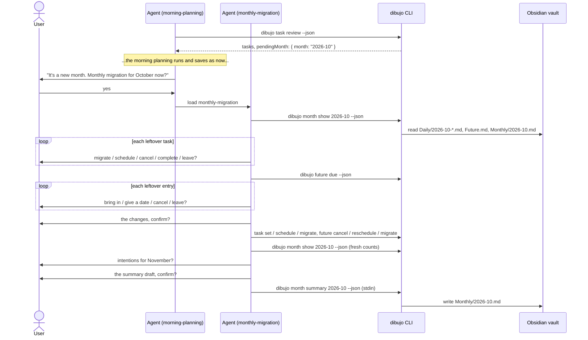

# Design: monthly migration

## Overview

The `monthly-migration` skill runs the conversation. Two new commands, in a new `month` group, do the vault work:

- `month show [YYYY-MM]` reads a whole month: every bullet, the leftover tasks, the counts, the moving tasks, and whether the monthly note has a summary. It writes nothing.
- `month summary [YYYY-MM]` writes the summary to `Monthly/YYYY-MM.md`. It computes the counts and the moving tasks itself.

Leftover tasks and future log entries are changed with the existing `task` and `future` commands. `task review` gets one new field, `pendingMonth`, which morning planning uses to offer the ritual.

As before, the CLI makes no LLM calls and skills never touch vault files.



## Answers to the open questions in the requirements

| Question | Answer |
| --- | --- |
| Command names and shape | A new `month` group: `month show [YYYY-MM]` and `month summary [YYYY-MM]`. See [CLI](#cli). |
| Where the pending month is reported | `task review` only, as `pendingMonth`. It is the first command morning planning runs, and it already takes `--date`. |
| How the CLI recognizes a summary | The note has a summary when it has any of the four section headings (`## Highlights`, `## Tasks done`, `## Tasks that kept moving`, `## Themes and intentions`) as an H2, case-insensitive, outside code fences. See [Recognizing a summary](#recognizing-a-summary). |
| Moving tasks across the month boundary | Only moves **out of** a note in the month count. A move into the 1st from the month before doesn't. A trip through the future log joins the chain, and counts as one move. See [Moving tasks](#moving-tasks). |
| Links in the summary | No links. A link would need a block id added to an old daily line, and the task's text is enough to find it with Obsidian search. |
| Leftover entries in `future due` | The existing fields are enough: `entries` with `daysOverdue > 0`, and `waiting` with no `date`. No change to `future due`. |
| Output size | No limit. A month is a few hundred bullets, which is a fine size for JSON. The plain output shows counts and leftovers only, not every bullet. |

## Vault format

Version 1 stays. This adds a new kind of note and changes no existing one (Requirement 10.2).

### The monthly note

Location: `<vault>/<folder>/Monthly/YYYY-MM.md`.

```markdown
---
dibujo: 1
type: monthly
month: 2026-10
---

# October 2026 summary

## Highlights

- moved into the new flat
- finished the first draft of the zine

## Tasks done

23

## Tasks that kept moving

- call the bank (moved 5 times)
- renew passport (moved 3 times)

## Themes and intentions

### Themes

- settling into the new flat
- slept badly most weeks

### Intentions

- go to bed by 11
- one zine page a week
```

- **Title.** An H1, `# <Month name> <year> summary`, which marks the note as a summary, not a record. English month names are fixed in code, so the output doesn't depend on the computer's locale.
- **Sections.** Four H2 sections in this order. **Tasks done** is the number only. **Tasks that kept moving** lists each moving task's latest text and how many times it moved. **Themes and intentions** has two H3 parts, so it stays one section (Requirement 5.3).
- **Empty sections.** The heading stays, with one line: `Nothing this month.` (highlights), `No task moved 3 or more times.` (moving, with the threshold), `None.` (themes, intentions). Tasks done is `0`.
- **Bullets** are plain list items (`- text`). They are not Bullet Journal bullets and dibujo never parses them.
- **No data blobs**, no tags, no links (Requirement 5.4).
- **Frontmatter** is written only when dibujo creates the note.

### Recognizing a summary

`hasSummary(content)` is true when `listHeadings` (from `note.ts`, which already skips the frontmatter and code fences) finds any of the four section names, case-insensitive. The title isn't checked, so the user can rename it.

- The user can edit the text in any section, and the note still has a summary.
- A note the user made by hand with other headings (for example `## Reading`) has no summary, and `month summary` appends one after it.
- If the user deletes all four headings, the month is pending again. This is documented, not prevented.

## Pure logic

### `src/bujo/journal-date.ts`

```ts
export function monthOf(date: string): string;               // "2026-10-31" → "2026-10"
export function previousMonth(month: string): string;        // "2026-01" → "2025-12"
export function parseMonthArg(value: string): string;        // "YYYY-MM", else INVALID_DATE
export function monthName(month: string): string;            // "2026-10" → "October 2026"
export function isDateInMonth(date: string, month: string): boolean;
```

Months are compared as strings, which is safe for `YYYY-MM`. `monthName` uses a fixed list of English names.

### `src/bujo/month.ts` (new)

```ts
export interface MonthNote { date: string; bullets: readonly ParsedBullet[] }

export interface TaskCounts {
  completed: number; cancelled: number; migrated: number; scheduled: number; open: number;
}

export interface MovingTask {
  text: string;
  moves: number;
  firstDate: string;     // date of the earliest copy in the month
  lastDate: string;      // date of the last copy in the month
  state: TaskState;      // state of the last copy in the month
}

export function countTasks(notes: readonly MonthNote[]): TaskCounts;
export function movingTasks(
  notes: readonly MonthNote[],
  future: readonly FutureBullet[],
  threshold: number,
): MovingTask[];
```

**`countTasks`** counts every task bullet in the notes, nested ones too, by state. A task that was migrated several times and then completed has one `[x]` line, so it is counted once as completed (Requirement 4.2). **Tasks done** is `completed`.

#### Moving tasks

A chain is a task and the copies it was moved to, linked by origin links. `movingTasks` builds chains from the notes in the month, then keeps the long ones.

1. **Index.** Every task in the notes that has a block id goes into a map, keyed by `date` and `blockId`. Every entry in `Future.md` with a block id goes into a second map.
2. **Predecessor.** For each task T in the notes, find the task it came from:
   - **Daily origin** `{ date, blockId }`, with `date` in the month: the task in the map, if its state is `migrated`.
   - **Future origin** `{ blockId }`: the future entry with that block id, if it was brought in (`[>]`) and its own origin is daily. Then the daily task that entry came from, if its date is in the month and its state is `scheduled`.
   - Anything else (no origin, a link out of the month, a missing line, a state that doesn't match): no predecessor. A broken link never throws (Requirement 4.6).
3. **Heads.** A head is a task that is nobody's predecessor: the last copy of its chain in the month.
4. **Walk.** From each head, follow predecessors, with a visited set against hand-made loops. The chain is the head and everything walked.
5. **Moves.** The number of tasks in the chain whose state is `migrated` or `scheduled`. The head counts too: a task migrated out of October 31 into November 1 moved once more in October. A move into the month's first note from the month before isn't counted, because its source isn't in the month.
6. **Nested tasks are left out.** A chain is kept only when its head isn't nested under a task. A child task moves with its parent, so listing it would repeat the parent.
7. **Keep** chains with `moves >= threshold` (the config's `migrationFlagDays`). The days don't need to be in a row (Requirement 4.3).
8. **Output** each chain once: the head's text and state, the head's date as `lastDate`, the earliest walked date as `firstDate`, and `moves`. Sorted by `moves` (most first), then `firstDate`.

### `src/bujo/monthly-note.ts` (new)

```ts
export const SummaryInput = z.object({
  highlights: z.array(BulletText).max(10).default([]),
  themes: z.array(BulletText).max(10).default([]),
  intentions: z.array(BulletText).max(10).default([]),
}).strict();
export type SummaryInput = z.infer<typeof SummaryInput>;

export function parseSummaryInput(json: string): SummaryInput;       // INVALID_INPUT with field paths
export function newMonthlyTemplate(month: string): string;           // frontmatter only
export function renderSummary(month: string, input: SummaryInput,
                              done: number, moving: readonly MovingTask[],
                              threshold: number): string[];
export function hasSummary(content: string): boolean;
export function appendSummary(original: string, lines: readonly string[]): string;
export function containsBlock(content: string, lines: readonly string[]): boolean;
```

- **Text rules.** Each item uses `BulletText` from `capture.ts`, the same rules as `log add`: one line, not empty, no reserved fields (Requirement 6.3). Up to 10 items per list keeps the summary short.
- **`renderSummary`** returns the lines from the title to the last section, in the format above.
- **`appendSummary`** inserts the lines after the last non-blank line, with one blank line before them, and keeps the line ending style. Like the other append functions, it checks `isSubsequence` and throws if any original line would be lost.
- **`containsBlock`** is true when the lines appear in the note in order, one after another. It is used to tell a rerun with the same input from a different one (Requirement 6.6).

## Vault operations

### `src/vault/paths.ts`

```ts
export function monthlyNotePath(config: VaultConfig, month: string): string;   // Monthly/YYYY-MM.md
export function dailyNoteDatesIn(config: VaultConfig, month: string): string[]; // sorted dates
```

`dailyNoteDatesIn` lists `Daily/`, keeps names matching `<month>-DD.md` that are real dates (`parseDateArg` in a try), and sorts them. A missing `Daily/` folder gives an empty list. It reads directory names only, so it is cheap.

### `src/vault/tasks.ts`

`reviewTasks` is split, so `month show` can list leftover tasks with the same rules and shape:

```ts
/** The open tasks in one parsed note that don't move with an open parent, as `task review` lists them. */
export function openTasksIn(
  parsed: ParsedNote, date: string,
  loadNote: (date: string) => ParsedNote | null, flagAfterDays: number,
): ReviewTask[];
```

`reviewTasks` calls it for yesterday, and keeps its result unchanged except for the new field below. `movesWithAncestor` and `movingDescendants` stay where they are.

**`pendingMonth`.** `ReviewResult` gets `pendingMonth: { month: string; path: string } | null`, from `pendingMonth(config, today)` in `vault/month.ts`. This only adds a field (Requirement 10.4).

### `src/vault/month.ts` (new)

```ts
export interface MonthView {
  month: string;
  today: string;
  flagAfterDays: number;
  notes: { date: string; path: string; bullets: NoteBullet[] }[];
  skipped: string[];                                   // paths with an unsupported version
  leftovers: (ReviewTask & { date: string; path: string })[];
  counts: TaskCounts;
  moving: MovingTask[];
  summary: { path: string; exists: boolean; hasSummary: boolean };
}

export function readMonth(config: VaultConfig, month: string, today: string): MonthView;
export function writeSummary(config: VaultConfig, month: string, today: string,
                             input: SummaryInput, options: { dryRun?: boolean; hooks?: WriteHooks }): SummaryResult;
export function pendingMonth(config: VaultConfig, today: string): { month: string; path: string } | null;
```

**`readMonth`**

1. Refuse a month that isn't before `monthOf(today)` with `INVALID_DATE` (Requirement 1.2).
2. For each date from `dailyNoteDatesIn`, read and parse the note. A note with an unsupported version goes into `skipped` and is left out of everything else (Requirement 1.5).
3. `notes`: each note's bullets with refs (`withRefs`).
4. `leftovers`: `openTasksIn` for each note, oldest note first, with the note's date and path. Streaks load earlier notes through a cache, as `reviewTasks` does.
5. `counts` and `moving` from `month.ts`. `Future.md` is loaded with `loadFutureNote`. If it has an unsupported version, the chains are built without it, so a trip through the future log just ends a chain.
6. `summary`: whether the monthly note exists and `hasSummary`. A monthly note with an unsupported version is reported as existing with a summary, so dibujo never tries to write to it.

**`writeSummary`**

1. Refuse the month of today or later (Requirement 6.4).
2. Read the monthly note. If it exists, check its version (`NOTE_VERSION_UNSUPPORTED`).
3. Compute `counts` and `moving` as `readMonth` does, from the notes on disk now (Requirement 6.2), and `renderSummary`.
4. If the note has a summary: `unchanged` when `containsBlock` finds the rendered lines, otherwise `SUMMARY_EXISTS`, with a hint to edit the note in Obsidian. Nothing is written.
5. Otherwise, the content is the template plus the summary (new note), or `appendSummary` on the existing note.
6. Write with `writeNew` or `replaceIfUnchanged`, so `NOTE_CHANGED` works as for daily notes. On a dry run, return the content and write nothing.

```ts
export interface SummaryResult {
  status: "created" | "updated" | "unchanged";
  month: string;
  path: string;
  done: number;
  moving: MovingTask[];
  dryRun: boolean;
  content?: string;      // dry runs only
}
```

**`pendingMonth`.** The past month is `previousMonth(monthOf(today))`. It is pending when `dailyNoteDatesIn` isn't empty and the monthly note doesn't exist or has no summary. It reads one directory listing and at most one note (Requirement 7.4). It never throws: an unreadable or unsupported monthly note counts as not pending, so `task review` keeps working.

## CLI

New files in `src/cli/`, with `registerMonth` added to `registers.ts`:

| File | Command |
| --- | --- |
| `month.ts` | the `dibujo month` group: "Read a past month and write its summary" |
| `month-show.ts` | `dibujo month show [YYYY-MM] [--date <YYYY-MM-DD>] [--json]` |
| `month-summary.ts` | `dibujo month summary [YYYY-MM] [--date <YYYY-MM-DD>] [--dry-run] [--json]`, JSON on stdin |

- **The month** argument defaults to the past month of `--date` (or today's journal date), and is checked with `parseMonthArg`.
- **`month show`** plain output: the month, the number of notes, the counts, the moving tasks, the leftover tasks with their refs, and whether there is a summary. Every bullet appears only in `--json`.
- **`month summary`** follows `log-add.ts` for stdin: it fails with `USAGE` when stdin is a terminal, and reads through `ctx.readStdin()`. Plain output says where the summary was written, or prints the note on a dry run.

```sh
dibujo month summary 2026-10 --json <<'DIBUJO_EOF'
{
  "highlights": ["moved into the new flat", "finished the first draft of the zine"],
  "themes": ["settling into the new flat", "slept badly most weeks"],
  "intentions": ["go to bed by 11", "one zine page a week"]
}
DIBUJO_EOF
```

`task review` plain output gets one line when a month is pending: `October 2026 has no monthly summary yet. Run the monthly migration.`

### JSON changes

| Command | Change |
| --- | --- |
| `task review` | **Added:** `pendingMonth` |
| `month show`, `month summary` | New |

## Skills

### `monthly-migration` (new)

Frontmatter `name: monthly-migration` and a `description` that says it walks through last month's leftover tasks and future log entries and writes a monthly summary, with triggers like "do my monthly migration", "review last month", "summarize October", and the offer from morning planning.

1. **Find the CLI**, as the other skills do.
2. **Read the month.** `dibujo month show [YYYY-MM] --json`. The month is the one morning planning offered, the one the user named, or the default. On `INVALID_DATE`, say the month isn't over yet. If `data.skipped` isn't empty, say which notes couldn't be read. If `data.summary.hasSummary`, say the month already has a summary at `data.summary.path`, and go on with steps 3 and 4 only.
3. **Leftover tasks.** Go through `data.leftovers` one at a time, oldest first, showing each with its date and children. The choices, wording, flagged-task rule, and child-task rule are the ones from morning planning's migration step, with these differences:
   - "migrate" means to today: `dibujo task migrate <ref> --json`;
   - a schedule date must be after today;
   - "leave" is followed once by: "It stays open in {date}'s note, and won't come up in a ritual again.";
   - "cancel the rest" or "leave the rest" applies to every remaining task.
4. **Leftover future log entries.** `dibujo future due --json`. The leftovers are `data.entries` with `daysOverdue > 0` and `data.waiting` with no `date`. One at a time: bring into today, give a date (after today), cancel, or leave. Same commands and wording as morning planning.
5. **Confirm and save the changes.** Show the changes from steps 3 and 4 in Bullet Journal symbols, grouped by note date and then the future log. Save after the user confirms, in morning planning's order (`task set` and `task schedule`, then `task migrate`, then the future log), with its error handling (`NOTE_CHANGED`, `TASK_NOT_FOUND`). Report what was saved.
6. **Draft the summary.** Unless the month has one, or the user skips it:
   - run `dibujo month show [YYYY-MM] --json` again, for counts that include the saved changes;
   - **highlights:** up to about 5 short bullets from the month's events, notes, and completed tasks, in the user's words;
   - **themes:** up to about 3 short bullets, drawn only from what is in the notes, with no advice or judgement;
   - **intentions:** ask once, "Any intentions for {next month}?" and use the user's words. "None" is an answer.
7. **Confirm and save the summary.** Show the whole summary as it will be written: the four sections, with `data.counts.completed` and `data.moving` exactly as the CLI gave them. Save after the user confirms, with `dibujo month summary [YYYY-MM] --json` and a quoted heredoc. Report from `data.status` and `data.path`. On `SUMMARY_EXISTS`, say a summary was written in the meantime and that nothing was changed.
8. **Skipping.** Any step with nothing in it is skipped silently. The user can skip any step or prompt. If the summary is skipped, say the month will be offered again tomorrow.

Rules at the top, as in the other skills: never edit vault files, use the user's words, don't push, and never claim a save that didn't happen. A link to `references/vault-format.md`.

### `morning-planning`

- **Step 2:** keep `data.pendingMonth` from `task review`.
- **New step 12, after the report:** if `pendingMonth` isn't null, ask once: "It's a new month. Would you like to do the monthly migration for {month name} now?" On yes, load the `monthly-migration` skill and follow it for that month. On no or later, end. Say nothing when it is null.
- **Description:** add that it offers the monthly migration when a new month starts.

No other step changes.

## Format document

`docs/vault-format.md` gets:

- "Where notes live": `Monthly/YYYY-MM.md`.
- A "Monthly note" section: the example above, the frontmatter, the four sections and what dibujo writes in each, the empty-section lines, how a summary is recognized, and that dibujo never changes a note that has one.
- How **tasks done** and **tasks that kept moving** are counted, in plain words.
- "Versioning": still 1, and why.

## Error handling

One new runtime error code in `src/errors.ts`:

| Code | When | Hint |
| --- | --- | --- |
| `SUMMARY_EXISTS` | `month summary` for a month whose note already has a different summary | "Edit Monthly/YYYY-MM.md in Obsidian. Nothing was written." |

Reused: `INVALID_DATE` (bad month, the month isn't over), `INVALID_INPUT` (bad summary JSON), `USAGE` (stdin is a terminal), `NOTE_CHANGED`, `NOTE_VERSION_UNSUPPORTED`.

## Testing

Limited to the core logic, as the spec says.

| Area | Tests |
| --- | --- |
| `journal-date.ts` | `monthOf`, `previousMonth` across a year, `parseMonthArg` (good, bad shape, month 13), `monthName`. |
| `month.ts` | `countTasks` with nested tasks, and a migrated-then-completed task counted once. `movingTasks`: a chain over non-consecutive days, the threshold edge, a trip through the future log, a move in from the month before not counted, a head migrated out of the month counted, nested tasks left out, a broken link, a hand-made loop. Property test: `moves` is never more than the number of tasks in the month. |
| `monthly-note.ts` | Rendering with all sections full and all empty. `hasSummary` with renamed title, other headings, headings in a code fence. `appendSummary` keeps every line (property test with `isSubsequence`). `parseSummaryInput` rejects unknown fields and bad text. |
| `vault/month.ts` | `readMonth`: leftovers in order, a skipped note, the current month refused. `writeSummary`: create, append to a hand-made note, the same input again (`unchanged`), a different input (`SUMMARY_EXISTS`), dry run. `pendingMonth`: no notes, notes and no summary, summary written, unsupported note. |
| `vault/tasks.ts` | `reviewTasks` unchanged apart from `pendingMonth`. |
| `cli` | One cycle: `month show`, then `task migrate` on a leftover, then `month summary`, then `task review` shows no pending month. |
| `docs` | The `vault-format.md` monthly example has a summary by `hasSummary`. |

Not tested: the skills (manual, as before).

**Manual checks**, for the tasks file: the monthly note reads well in Obsidian, and a real run of morning planning on a new month that leads into the monthly migration.

## Files

| Area | Files |
| --- | --- |
| Pure logic | `src/bujo/journal-date.ts`, `month.ts` and `monthly-note.ts` (new) |
| Vault | `src/vault/paths.ts`, `tasks.ts`, `month.ts` (new) |
| CLI | `src/cli/month.ts`, `month-show.ts`, `month-summary.ts` (new), `task-review.ts`, `registers.ts` |
| Errors | `src/errors.ts` |
| Skills and docs | `skills/monthly-migration/SKILL.md` (new), `skills/morning-planning/SKILL.md`, `docs/vault-format.md`, `README.md` |
| Tests | the rows above |
