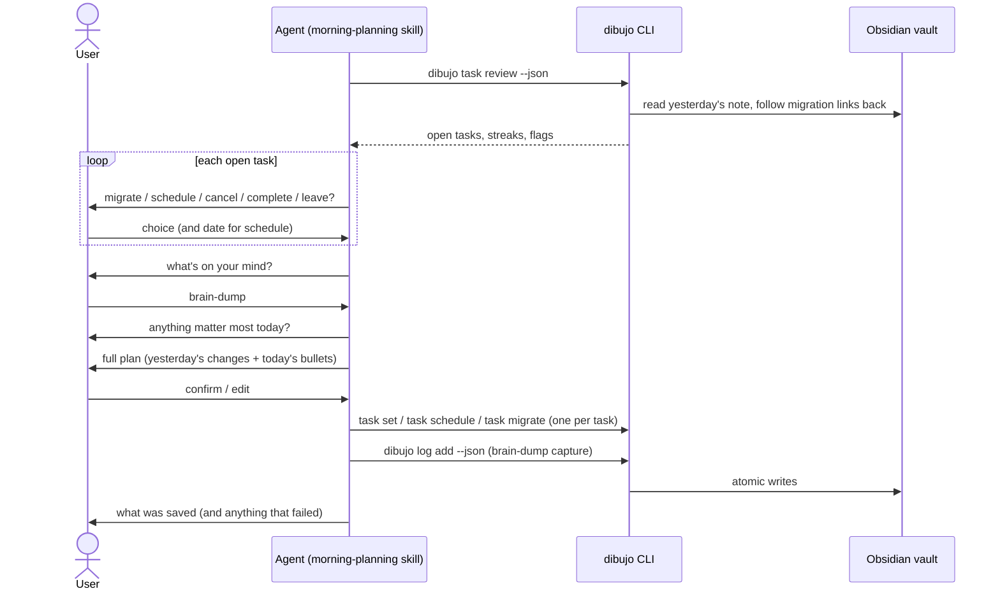

# Design: morning planning

## Overview

The `morning-planning` skill runs the conversation. Four new `task` commands do the vault work:

- `task review` lists yesterday's open tasks with their migration streaks.
- `task set` changes a task's state.
- `task schedule` marks a task scheduled and stores its date.
- `task migrate` moves a task, with its nested bullets, to today and links the copy back to the original.

The brain-dump reuses `dibujo log add` unchanged. As in `core-daily-log`, the CLI makes no LLM calls and the skill never touches vault files.



The agent collects every answer before writing anything. Nothing is saved until the user confirms the full plan (Requirement 5.9).

## Vault format changes

### New fields at the end of a bullet line

A bullet line can now end with up to three more fields, in addition to signifier tags:

| Field | Syntax | Written on | Purpose |
| --- | --- | --- | --- |
| Origin link | `[[<folder>/Daily/YYYY-MM-DD#^id\|from YYYY-MM-DD]]` | Migrated copies | Links the copy back to the task it came from (Requirement 2.7) |
| Scheduled date | `⏳ YYYY-MM-DD` | Scheduled tasks | Tasks plugin scheduled date (Requirement 3.2) |
| Block id | `^id` | Tasks that were migrated away | The anchor that the origin link points at (Requirement 2.8) |

dibujo writes them in this order:

```
<indent><marker><text> <origin link> <signifier tags> <⏳ date> <^id>
```

Example, with a task migrated twice and then scheduled:

```markdown
2026-11-08:  - [>] call the bank #priority ^k3f9a1
2026-11-09:  - [>] call the bank [[Bujo/Daily/2026-11-08#^k3f9a1|from 2026-11-08]] #priority ^p07c2e
2026-11-10:  - [<] call the bank [[Bujo/Daily/2026-11-09#^p07c2e|from 2026-11-09]] #priority ⏳ 2026-11-20
```

Why this order:

- **Block id last.** Obsidian only recognizes `^id` as the final token of a line.
- **Scheduled date after the tags.** The Tasks plugin reads its emoji fields from the end of the description, and it allows tags among them.
- **Origin link before the tags.** It reads as part of the task ("call the bank, from Nov 8") in both Obsidian and the raw Markdown.
- **Full path in the link.** `Bujo/Daily/2026-11-08` still resolves when another note in the vault is also named `2026-11-08` (Requirement 2.7). The link uses `#^id`, so clicking it opens the source note scrolled to that line, and Obsidian lists the copy in the source note's backlinks pane. No plugins are needed.
- **Alias `from YYYY-MM-DD`.** Obsidian shows the alias instead of the path, so the line stays short in reading view.

### Parsing the new fields

`parseBulletLine` strips trailing fields from the end of the line in a loop, accepting them **in any order**, because people edit by hand. Each pass removes one of these:

| Field | Pattern (anchored at end of line) |
| --- | --- |
| Block id | `\s+\^([A-Za-z0-9-]+)$` |
| Scheduled date | `\s+⏳\s*(\d{4}-\d{2}-\d{2})$` |
| Signifier | `\s+#(priority\|inspiration)$` (unchanged) |
| Origin link | `\s+\[\[([^\]\|#]*?)(\d{4}-\d{2}-\d{2})#\^([A-Za-z0-9-]+)(?:\|[^\]]*)?\]\]$`, where the path part is empty or ends in `Daily/` |

The loop stops at the first token that matches none of these. Everything before that point is `text`. A field that appears twice keeps the one nearest the end, and the other copy stays in the text. Fields in the middle of the text stay in the text, just like signifier tags today.

The origin link pattern accepts `[[2026-11-08#^k3f9a1]]` (basename only, typed by hand) as well as the full path, and ignores the alias. That covers Requirement 6.3.

Block ids are parsed on every bullet type, because Obsidian adds `^id` itself when the user links to any block. This changes one existing behavior: a hand-made block id no longer shows up in `text`. dibujo still only writes block ids on migrated tasks.

### Bullet model

```ts
export interface Bullet {
  type: BulletType;
  state?: TaskState;
  signifiers: Signifier[];
  text: string;
  depth: number;
  origin?: { date: string; blockId: string }; // new
  scheduled?: string;                         // new, YYYY-MM-DD
  blockId?: string;                           // new
}
```

`formatBullet` writes the new fields in the canonical order shown above. The round trip `parseBulletLine(formatBullet(b))` equals `b` for every valid bullet, including the new fields.

`formatBullet` needs the dibujo folder to build the origin link's path, so it takes an optional `{ folder }` argument. Without it, origin links are written basename-only. Only migration passes a folder.

### Capture input

The capture schema has no new fields. Agents can't set an origin, a scheduled date, or a block id through `log add`. To keep the round trip exact, `BulletInput.text` gets three more refinements:

- It must not contain `⏳`.
- It must not end with a `^id`-like token.
- It must not end with a `[[…#^…]]` link.

### Format version

The format stays at **version 1** (Requirement 6.4).

- Every new field is optional, so notes written by the `core-daily-log` CLI are still valid.
- The only reader that would misread new notes is the `core-daily-log` CLI itself. It would show the fields as text and miss signifiers that come before them. That version was never published, so no installed reader exists.

`docs/vault-format.md` gets a new "Task fields" section covering the table, the order, and the parsing rules. It also gets a "Migration" section that explains `[>]`, the link, and how streaks are counted. The example blocks that `tests/docs/vault-format.test.ts` parses are extended to include the new fields.

## Identifying a task: refs

Every command that changes a task takes a **ref**:

```
<date>:<line>:<fingerprint>      e.g. 2026-11-09:7:9c04e7d1
```

- `date` is the note's journal date, and `line` is the 1-based line number.
- `fingerprint` is the first 8 hex characters of the sha256 of a canonical JSON of the bullet's **identity**: `{ type, depth, text, signifiers, origin }`.
- State, scheduled date, and block id are left out of the fingerprint. A task's ref therefore stays the same after dibujo changes its checkbox, adds `⏳`, or adds `^id`. That makes every command safe to retry with the same ref (Requirement 2.6).
- Refs contain only digits, dashes, colons, and hex characters, so the agent can pass them as plain arguments. No user text goes through the shell.

`log show --json` and `task review --json` both return a `ref` for every bullet. The `ref` field is new and additive, so the existing `log show` output shape still works.

Resolving a ref (Requirement 1.3):

1. Read the note for `date`. If it doesn't exist, fail with `TASK_NOT_FOUND`.
2. If the bullet at `line` has a matching fingerprint, use it.
3. Otherwise, the user may have added or removed lines above it. Look for bullets in `## Log` with that fingerprint. If exactly one exists, use it.
4. If none or more than one match, change nothing and fail with `TASK_NOT_FOUND`. Its hint says to run `task review` or `log show` again.
5. If the bullet isn't a task, fail with `NOT_A_TASK` (Requirement 1.4).

## Editing lines in place

The `core-daily-log` writer only appends, and it checks that every original line survives (`isSubsequence`). State changes need to edit existing lines, so there is a new pure module, `src/bujo/edit.ts`:

```ts
export interface LineEdit { line: number; before: string; after: string } // 1-based
export function applyLineEdits(original: string, edits: readonly LineEdit[]): string;
export function setCheckbox(line: string, state: TaskState): string;
export function setScheduled(line: string, date: string): string;
export function addBlockId(line: string, id: string): string;
```

- **`setCheckbox`** replaces only the single character between `[` and `]`. Indent, list marker (`*`, `+`, `-`), spacing, and everything after `] ` stay byte-for-byte the same (Requirement 1.2).
- **`setScheduled`** replaces the date inside an existing `⏳` field. If the line has no `⏳` field, it inserts ` ⏳ <date>` before a trailing block id, or at the end of the line (Requirement 3.3).
- **`addBlockId`** appends ` ^<id>` after trimming trailing whitespace. A line that already has a block id is returned unchanged.
- **`applyLineEdits`** is the guard. It throws, which surfaces as `INTERNAL` and writes nothing, unless all of these hold:
  - the line count is unchanged;
  - each edited line still equals its `before` value;
  - every other line is identical;
  - each `after` line parses to a bullet with the same fingerprint as `before`.

  So an edit can change a line's state, scheduled date, or block id, but never its words, signifiers, indent, or origin. The original line ending is kept.

Writes reuse `replaceIfUnchanged` from `core-daily-log`, which re-reads the note, compares the full content, and then renames (Requirement 1.6).

## Migration

### What gets migrated

`planMigration(note, root, opts)` in `src/bujo/migrate.ts` is pure. It takes the parsed source note, the root task, and an id generator.

1. **Subtree.** The subtree is the root plus the following bullets that are deeper than it, up to the first bullet at the same depth or shallower. Unrecognized and blank lines inside the subtree are left in the source and not copied.
2. **Classify** each bullet, walking down the tree:

   | Bullet | Source note | Target note |
   | --- | --- | --- |
   | Open task (including the root) | Set to `[>]`, add `^id` | Copied as an open task, with an origin link to `^id` |
   | Task already `[>]` with a block id, when the root is too (an interrupted run) | Unchanged | Copied, with an origin link, if missing |
   | Event or note | Unchanged | Copied as-is |
   | Completed, scheduled, or cancelled task, or a `[>]` task when the root is open | Unchanged | Not copied, **and neither is anything nested under it** |

   Skipping a whole branch keeps the copied nesting valid. An open task nested under a completed one stays open in the source. Monthly migration will find it later.
3. **Depth.** Copies are re-based so the root lands at depth 0, and nesting is capped at `MAX_WRITE_DEPTH` (3).
4. **Block ids.** An existing block id is reused. A new id is 6 random base36 characters, regenerated if the id is already used anywhere in the note. Ids come from `opts.newId`, so the planner stays pure and tests are deterministic.
5. **Priority.** With `--priority`, the root's copy gets the `priority` signifier added. Only the new line in today's note changes, so this never edits user-written content. The skill uses it for step 3 (Requirement 5.7).

The root must be an open task, or a migrated task with a block id (resuming). Anything else fails with `TASK_NOT_OPEN`. The target date must be later than the source date, or the command fails with `INVALID_DATE`. It defaults to today's journal date.

### Write order and retries

Migration touches two notes, and the filesystem has no transaction that covers both. Requirement 2.6 is met by ordering the writes so that a retry always finishes the job:

1. **Source first.** Apply the `[>]` and `^id` edits with `applyLineEdits` and `replaceIfUnchanged`. If nothing changed, skip the write.
2. **Target second.** Read the target note, or start from the template. If it already has a task whose origin is `{ sourceDate, rootBlockId }`, the target is `unchanged` (Requirement 2.5). Otherwise, append the copied block to the end of `## Log` in one atomic write. Use `writeNew` for a new note and `replaceIfUnchanged` for an existing one.

| Interrupted after | State on disk | Running the same `task migrate <ref>` again |
| --- | --- | --- |
| Nothing written | Source open | Full migration |
| Source written | Source `[>] … ^id`, no copy in target | The ref still resolves, because the fingerprint ignores state and block id. The root counts as a resumed migration, and the target block is added. |
| Both written | Done | Source and target `unchanged` |

The target block is always written in one atomic write, so checking for the root's copy is enough to dedupe the whole block. Once the copy is there, the migration is finished and neither note is changed again. A rerun can't tell this run's `[>]` children from ones migrated on an earlier day, so it must not apply new source edits.

Appending to the Log without a capture callout needs a new pure function, `appendLogLines(original, lines)`, in `note.ts`. It shares `appendToSection` and the `isSubsequence` guard with `appendCapture`. No callout is written, because a migration isn't a capture.

### Link path safety

The origin link is built from `config.folder`. If the folder contains `[`, `]`, `|`, `#`, or `^`, the link would break. In that case `task migrate` fails with `CONFIG_INVALID` before writing anything, with a hint to rename the folder. The folder schema doesn't change, so existing configs keep loading for every other command.

## Migration streaks

`migrationStreak(task, loadNote)` lives in `src/vault/tasks.ts`. `loadNote(date)` returns a parsed note or `null`, and results are cached for one command run.

```
streak = 0; since = null; current = task; currentDate = yesterday
loop:
  o = current.origin
  if o is missing, or o.date ≠ currentDate − 1 day: stop
  source = loadNote(o.date)?.bullets.find(b => b.blockId === o.blockId)
  if source is missing, or it isn't a task in state migrated: stop
  streak += 1; since = o.date; current = source; currentDate = o.date
```

- A missing note, a deleted line, an unsupported note version, or a link to a non-adjacent day ends the streak. None of them is an error (Requirement 4.4).
- Dates go strictly backward, so the loop always terminates.
- `flagged = streak >= config.migrationFlagDays` (Requirement 4.5).
- Example: a task moved Mon → Tue → Wed → Thu is reviewed on Friday from Thursday's note. Its streak is 3, `since` is Monday, and with the default threshold it's flagged.

## CLI

### Commands

| Command | Purpose | Requirement |
| --- | --- | --- |
| `dibujo task review [--date <today>] [--json]` | Yesterday's open tasks, with streaks and flags | 4 |
| `dibujo task set <ref> <state> [--dry-run] [--json]` | Change a task's checkbox: `open`, `completed`, `migrated`, `scheduled`, or `cancelled` | 1 |
| `dibujo task schedule <ref> <date> [--dry-run] [--json]` | Mark a task `[<]` and set `⏳ <date>` | 3 |
| `dibujo task migrate <ref> [--to <date>] [--priority] [--dry-run] [--json]` | Migrate a task and its nested bullets | 2 |

- `task review --date` names "today", and the command reviews the day before it. Without `--date`, it uses the current journal date.
- `task set` changes only the checkbox, so `task set <ref> migrated` marks a task `[>]` without copying it. That's for tasks migrated on paper to somewhere other than a daily log. The skill always uses `task migrate`. `task set <ref> scheduled` doesn't add a date. The skill uses `task schedule`.
- `task schedule` works on open or scheduled tasks, so a task can be rescheduled. The date must be later than the note's date.
- When a task leaves the scheduled state through `task set`, its `⏳` field stays, because `task set` only ever touches the checkbox.

### JSON output

`task review`:

```jsonc
{
  "ok": true,
  "data": {
    "today": "2026-11-10",
    "yesterday": "2026-11-09",
    "path": "/…/Bujo/Daily/2026-11-09.md",
    "exists": true,
    "flagAfterDays": 3,
    "tasks": [
      {
        "ref": "2026-11-09:7:9c04e7d1",
        "text": "call the bank",
        "signifiers": ["priority"],
        "depth": 0,
        "streak": 3,
        "since": "2026-11-06",
        "flagged": true,
        "children": [
          { "ref": "2026-11-09:8:51aa03fe", "type": "task", "state": "open", "text": "find card number", "signifiers": [], "depth": 1 },
          { "ref": "2026-11-09:9:0b7d4c11", "type": "note", "text": "they close at 5", "signifiers": [], "depth": 1 }
        ]
      }
    ]
  }
}
```

- `tasks` lists every open task whose parent isn't an open task. That includes open tasks nested under a note, an event, or a finished task.
- `children` holds the full subtree that would move with the task. That way the agent can show it and, when the parent isn't migrated, ask about open child tasks individually (Requirement 4.8).
- If yesterday has no note or no open tasks, `tasks` is `[]` and the exit code is 0 (Requirement 4.6).

`task set` and `task schedule`:

```jsonc
{ "ok": true, "data": { "status": "updated" | "unchanged", "ref", "path", "date", "state", "scheduled"?, "dryRun", "content"? } }
```

`ref` in the output is the task's current ref. Its line number may differ from the input if the line moved.

`task migrate`:

```jsonc
{
  "ok": true,
  "data": {
    "status": "migrated" | "unchanged",
    "source": { "path", "date", "status": "updated" | "unchanged" },
    "target": { "path", "date", "status": "created" | "updated" | "unchanged" },
    "migrated": 2,   // tasks marked [>] in this run
    "copied": 3,     // bullets added to the target
    "dryRun": false
    // dry run only: "sourceContent", "targetContent"
  }
}
```

`log show` bullets gain `ref`, plus `origin`, `scheduled`, and `blockId` when present. The human output shows `⏳ <date>` and `↩ <date>` after the text.

### New error codes

| Code | Exit | When |
| --- | --- | --- |
| `INVALID_REF` | 2 | The ref doesn't match `YYYY-MM-DD:<n>:<8 hex>`, or its date isn't real |
| `TASK_NOT_FOUND` | 1 | The note is missing, or no single bullet matches the ref. Hint: run `task review` or `log show` again. |
| `NOT_A_TASK` | 1 | The ref points to an event or a note |
| `TASK_NOT_OPEN` | 1 | `migrate` or `schedule` on a task in a state they don't accept. The message names the current state. |

Invalid `<state>` values are rejected by commander's `.choices()` and become `USAGE`. `INVALID_DATE` covers bad dates, and target dates that aren't later than the source date. Error messages never include task text.

## Configuration

A new key, `migrationFlagDays`:

| Key | Validation | Default | Env override |
| --- | --- | --- | --- |
| `migrationFlagDays` | Integer from 2 to 365 | `3` | none |

- `ConfigFileSchema` gets `migrationFlagDays: MigrationFlagDaysSchema.default(3)`. The schema already strips unknown keys and fills in defaults, so existing config files load unchanged and `CONFIG_VERSION` stays 1 (Requirement 7.5). An out-of-range value fails with `CONFIG_INVALID`, and zod names the key (Requirement 7.4).
- `LoadedConfig` gets a `SourcedValue<number>`. `VaultConfig` gets the field so that `task review` can read it.
- `dibujo init --flag-after-days <n>` sets it. There is no prompt (Requirement 7.2). If the flag isn't given, init keeps the existing value or uses the default. Invalid input is a `USAGE` error.
- `dibujo config` shows the value and its source (Requirement 7.3).

## The `morning-planning` skill

`skills/morning-planning/SKILL.md`:

```markdown
---
name: morning-planning
description: Run the user's Bullet Journal morning planning. Walk through yesterday's open tasks (migrate, schedule, cancel, complete, or leave open), then capture a morning brain-dump as bullets in today's note. Use when the user wants to plan their morning, start their day, or migrate yesterday's tasks.
---
```

The skill tells the agent to:

1. **Find the CLI.** This step is the same as in `daily-log`.
2. **Review.** Run `dibujo task review --json`. If `tasks` is empty, say so in one line and go to step 4.
3. **Migration.** For each task, one at a time, show it (with its children) and ask what the user did on paper.
   - Accept short answers: "migrate" / ">", "schedule" / "<" (then ask for the date), "cancel" / "drop", "done", "leave", or "skip".
   - If `flagged` is true, say how many days in a row the task has been migrated, using `streak` and `since`. Ask whether to keep it or drop it, without recommending either (Requirement 5.4).
   - If the parent isn't migrated, ask about each open child task too.
4. **Brain-dump.** Ask once: "What's on your mind this morning?" Turn the answer into bullets using the same rules as `daily-log`. Those rules are repeated in the skill, because an installed skill can't rely on another skill being present. Don't ask about mood, sleep, gratitude, or events (Requirement 5.6). Skip any bullet that's already in today's note.
5. **Priority.** Ask once whether anything matters most today. Set `priority` only on bullets the user names. For a migrated task, this means passing `--priority` to `task migrate`.
6. **Confirm.** Show the whole plan in Bullet Journal symbols: yesterday's changes first, then today's new bullets. Wait for confirmation. If the user changes anything, show the plan again.
7. **Save.** Run the commands in this order: `task set` and `task schedule`, then `task migrate`, then `log add` (with a quoted heredoc, as in `daily-log`).
   - On `NOTE_CHANGED`, retry that command once with the same ref.
   - On `TASK_NOT_FOUND`, rerun `task review` and match the task by its text and children, then retry once.
8. **Report.** List what was saved and what failed, each by task. Never report a change as saved unless its command returned `"ok": true` (Requirement 5.11).

**Skipping (Requirement 5.8):** "skip", "nothing", or "no" moves on to the next step. Steps with nothing to review aren't shown. If every step was skipped or answered "leave", the agent saves nothing and says so.

The skill doesn't mention how it was started, so a reminder can launch it later (Requirement 5.12). `skills install` picks up the new folder automatically.

## Module layout

New and changed files:

```
src/
├── bujo/
│   ├── types.ts           # Bullet gains origin, scheduled, blockId
│   ├── bullet.ts          # trailing-field parsing, canonical formatting, fingerprint()
│   ├── capture.ts         # extra text refinements
│   ├── note.ts            # appendLogLines; parse keeps raw lines for edits
│   ├── edit.ts            # NEW: setCheckbox, setScheduled, addBlockId, applyLineEdits
│   ├── migrate.ts         # NEW: planMigration (subtree, classification, copies)
│   ├── ref.ts             # NEW: formatRef, parseRef
│   └── journal-date.ts    # addDays(date, n)
├── vault/
│   ├── daily.ts           # export readIfExists/assertSupported; refs in readDailyNote
│   └── tasks.ts           # NEW: resolveRef, setTaskState, scheduleTask, migrateTask, reviewTasks, migrationStreak
├── cli/
│   ├── task.ts            # NEW: `task` group
│   ├── task-review.ts     # NEW
│   ├── task-set.ts        # NEW
│   ├── task-schedule.ts   # NEW
│   ├── task-migrate.ts    # NEW
│   ├── registers.ts       # add registerTask
│   ├── init.ts            # --flag-after-days
│   ├── config-show.ts     # show migrationFlagDays
│   └── log-show.ts        # show ⏳ / ↩ in human output
├── config.ts              # migrationFlagDays
└── errors.ts              # INVALID_REF, TASK_NOT_FOUND, NOT_A_TASK, TASK_NOT_OPEN
skills/morning-planning/SKILL.md   # NEW
docs/vault-format.md               # task fields, migration
```

Dependencies still point one way: `cli` → `vault` → `bujo`. `edit.ts`, `migrate.ts`, and `ref.ts` are pure. Random ids and file reads are passed in from `vault/`.

## Testing strategy

All tests use `vitest --run` with temp vaults and a fixed clock, as in `core-daily-log`.

- **`bujo/bullet`:**
  - A table of lines with the new fields, in canonical order and in shuffled hand-edited orders.
  - A field in mid-text stays in the text.
  - Basename-only origin links parse.
  - A Daily Notes–style line with an Obsidian block id parses.
  - Round trip for bullets with every combination of the new fields.
- **`bujo/edit`:**
  - `setCheckbox` keeps `* [ ]`, `+ [ ]`, and space indents byte for byte.
  - `setScheduled` inserts before `^id` and replaces an existing date.
  - `applyLineEdits` rejects edits that change text, signifiers, or other lines.
- **`bujo/migrate`:** subtree boundaries, each row of the classification table, skipping a branch under a completed task, depth re-basing and capping, block-id reuse and collision retry, and `--priority`.
- **`bujo/ref`:** formatting and parsing, and that the fingerprint doesn't change across state, schedule, and block-id edits.
- **`vault/tasks`:**
  - A ref relocates after a line is inserted above it, and an ambiguous or missing match gives `TASK_NOT_FOUND`.
  - Migrate into a new note, into an existing note, and as a rerun (`unchanged`).
  - Resume after a simulated failure between the two writes, using the existing `WriteHooks`.
  - `NOTE_CHANGED` on the source, and on the target.
  - Streaks: a chain of 4 days, a gap day, a deleted source line, a link to a non-adjacent day, and an unsupported note version mid-chain. Flagging at the configured threshold.
- **`config`:** old config files load with the default threshold, out-of-range values give `CONFIG_INVALID`, and `init --flag-after-days` sets the value.
- **CLI:** each `task` command end-to-end through `runCli`. `--json` output always parses, and exit codes match for each new error code. `--dry-run` writes nothing.
- **Docs:** `tests/docs/vault-format.test.ts` covers the new example blocks.

- **Property-based tests** use `fast-check`, a new dev dependency that isn't published with the package. They cover:
  - the bullet round trip with every combination of the new fields;
  - the ref round trip;
  - fingerprints not changing under state, schedule, and block-id edits;
  - the `applyLineEdits` guard leaving every other line untouched;
  - migration plans always giving valid nesting and links;
  - running `migrateTask` twice giving the same files as running it once.

## Requirement coverage

| Requirement | Covered by |
| --- | --- |
| 1 Changing a task's state | `bujo/edit.ts`, `bujo/ref.ts`, `vault/tasks.ts` (`resolveRef`, `setTaskState`), `cli/task-set.ts` |
| 2 Migrating a task | `bujo/migrate.ts`, `note.ts` (`appendLogLines`), `vault/tasks.ts` (`migrateTask`), `cli/task-migrate.ts`, [Write order and retries](#write-order-and-retries) |
| 3 Scheduling | `edit.ts` (`setScheduled`), `vault/tasks.ts` (`scheduleTask`), `cli/task-schedule.ts` |
| 4 Reviewing yesterday | `vault/tasks.ts` (`reviewTasks`, `migrationStreak`), `cli/task-review.ts` |
| 5 Skill | `skills/morning-planning/SKILL.md` |
| 6 Vault format | `bujo/bullet.ts`, `docs/vault-format.md`, [Format version](#format-version) |
| 7 Flag threshold | `config.ts`, `cli/init.ts`, `cli/config-show.ts` |
