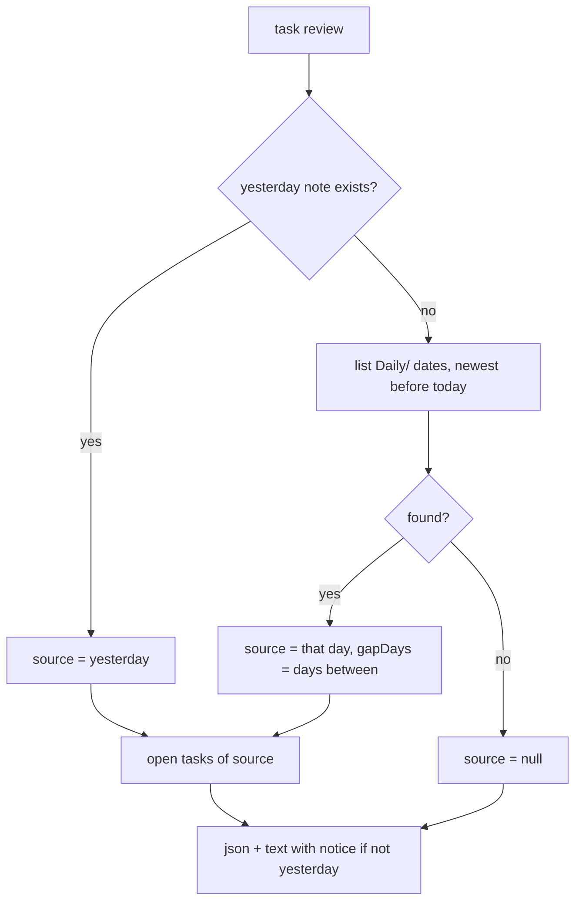

# Design: morning review fallback

## Overview

Two small code changes and one skill change:

1. `src/vault/paths.ts` gets `dailyNoteDates(config)`: every daily note date in `Daily/`, across all months.
2. `src/bujo/journal-date.ts` (pure) gets `pickSourceDay(today, noteDates)` and `gapDays(source, today)`.
3. `reviewTasks` in `src/vault/tasks.ts` uses them, and returns a `source` field.
4. `src/cli/task-review.ts` prints the fallback notice.
5. `skills/morning-planning/SKILL.md` step 2 reads `data.source`.

`task migrate`, `task set`, `task schedule`, refs, and the note format do not change. `migrateTask` already accepts any source date earlier than the target (`to <= task.date` is the only check).



## Components

### `dailyNoteDates(config): string[]` (`src/vault/paths.ts`)

Reads `Daily/` once, as `dailyNoteDatesIn` does, but without the month filter. It keeps names matching `DAILY_FILE`, validates each with `parseDateArg`, drops invalid ones, and returns the dates sorted ascending. A missing `Daily/` folder gives `[]`. `dailyNoteDatesIn(config, month)` is rewritten to filter this list with `isDateInMonth`, so the two cannot drift.

All paths go through `resolveInVault`, as the steering rules require.

### Pure helpers (`src/bujo/journal-date.ts`)

```ts
/** The latest date in `dates` that is before `today`, or null. */
export function latestBefore(today: string, dates: readonly string[]): string | null;

/** Calendar days strictly between `source` and `today`. 0 when source is yesterday. */
export function gapDays(source: string, today: string): number;
```

`gapDays` is `differenceInCalendarDays(today, source) - 1`, via the existing date helpers, so DST does not matter. `latestBefore` compares `YYYY-MM-DD` strings, which sort correctly. Dates equal to or after `today` are skipped.

### `reviewTasks` (`src/vault/tasks.ts`)

```ts
export interface ReviewSource {
  date: string;
  path: string;
  isYesterday: boolean;
  gapDays: number;
}

export interface ReviewResult {
  // existing fields unchanged; path and exists still describe yesterday
  source: ReviewSource | null;
}
```

Flow:

1. `yesterday = addDays(today, -1)`. `yesterdayPath = dailyNotePath(...)`. `content = readIfExists(yesterdayPath)`.
2. If `content !== null`: `sourceDate = yesterday`.
3. Else: `sourceDate = latestBefore(today, dailyNoteDates(config))`. If `null`, return `{ exists: false, tasks: [], source: null, pendingMonth }`.
4. Read the source note (`readIfExists`). If it vanished between the listing and the read, treat it as `source: null` (no error).
5. `parseDailyNote`, `assertSupported(parsed, sourcePath)`.
6. Build the `loadNote` cache keyed by `sourceDate`, and call `openTasksIn(parsed, sourceDate, loadNote, flagDays)`.
7. Return the existing fields plus `source`.

`openTasksIn` and `migrationStreak` already take the note's date as a parameter, so the streak rule "origin must be the day before the task's own date" applies to the source day with no change. A task that was migrated into the source day from three days before it has a streak of 0, as the rule for non-adjacent origins already says.

The `ReviewTask.streak` doc comment changes from "ending with the move into yesterday" to "ending with the move into the source day".

### CLI text (`src/cli/task-review.ts`)

Builds a notice line from `review.source`:

| Case | Lines |
| --- | --- |
| `source === null` | `No note for <yesterday>, and no earlier notes.` |
| `source.isYesterday` | unchanged output |
| fallback | `No note for <yesterday>. Showing open tasks from <Weekday> <date> instead (<n> day(s) with no notes in between).` |

The heading `Open tasks from <date>:` uses `source.date`. The empty-list line says `No open tasks in <source.date>'s note.` The weekday comes from `date-fns` `format(parseISO(date), "EEEE")`. A small `plural(n, "day")` helper handles "1 day".

`gapDays` here counts days with no note, since every day between the source and today has none (the source is the most recent earlier note, and yesterday is missing). The text says "days with no notes in between" and that is true by construction.

### Skill (`skills/morning-planning/SKILL.md`, step 2)

Replace the `"ok": true` bullets with:

- Keep `data.source`.
- `source` is `null`: "No earlier notes." Go to step 4.
- `source.isYesterday` is false: say, before any task: "There's no note for yesterday. These tasks are from `<weekday> <date>`, and there are no notes for the days between." Then continue.
- `data.tasks` is empty: "Nothing open from `<yesterday | weekday date>`." Go to step 4.
- In all later prompts and the plan summary, refer to the source day by name ("from Friday").

The scheduling rule changes to: a scheduled date must be after today's date minus 0, that is, in the future; give the source day's date in the error wording.

Step 2 keeps `data.pendingMonth` handling as is.

## Edge cases

| Case | Result |
| --- | --- |
| Yesterday has a note with no open tasks | Source = yesterday. No fallback. |
| Note 5 days back is the latest | Source = that day, `gapDays` = 4. |
| Gap crosses a month or year end | Works, because the list covers all of `Daily/`. |
| Notes dated today or later exist | Ignored. |
| `Daily/2026-13-45.md` or `notes.md` | Ignored. |
| Latest earlier note has an unsupported format version | `assertSupported` error, same as yesterday today. |
| `--date` is a past date | Same rules, relative to that date. |
| Latest earlier note's open task has children | They move with it, as before. |

## Testing

- Unit (`tests/bujo/journal-date.test.ts`): `latestBefore` and `gapDays` table tests, including month and year ends and a DST change day. A `fast-check` property: for any set of dates and a `today`, `latestBefore` returns an element strictly less than `today`, and no element of the set lies strictly between it and `today`.
- Vault (`tests/vault/paths.test.ts`): `dailyNoteDates` across several months, with junk file names; `dailyNoteDatesIn` still returns the same results as before.
- Vault (`tests/vault/tasks.test.ts`): the cases in Requirement 5.3, plus migrating a fallback task and checking the link and the `[>]` mark.
- CLI (`tests/cli/task-review.test.ts`): the three text cases, the JSON shape of `source`, and the plural.
- Skill: read `SKILL.md` step 2 after the edit against Requirement 4. Then run `npm run dev -- skills install --target .kiro/skills`.
